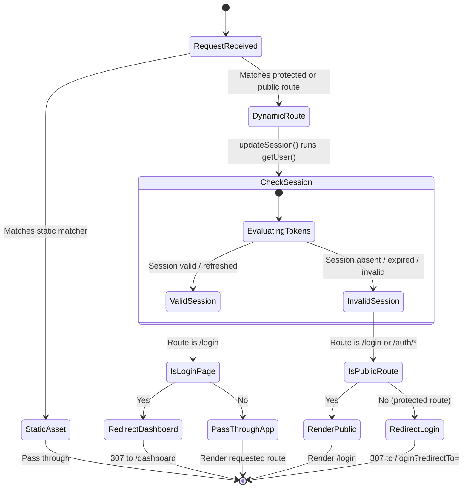

# Data Model & Storage Specifications: Supabase SSR Authentication & Session Protection

**Feature Key**: `ARL-2`  
**Feature Slug**: `001-supabase-ssr-auth`  

---

## 1. Entities & Domain Models

### Entity: AdminUser (Supabase Auth `User`)
Represents an authenticated store administrator. Stored in Supabase Auth's internal `auth.users` catalog.

| Field | Type | Required | Description |
| :--- | :--- | :--- | :--- |
| `id` | `UUID` (string) | Yes | Unique identifier assigned by Supabase Auth. |
| `email` | `string` | Yes | Unique administrator email used for credential verification. |
| `role` | `string` | Yes | Supabase user role (defaults to `authenticated`). |
| `created_at` | `ISO-8601 string` | Yes | Account creation timestamp. |
| `last_sign_in_at` | `ISO-8601 string` | No | Timestamp of the most recent successful login. |

---

### Entity: AdminSession (Supabase Auth `Session`)
Represents an active authenticated session token pair.

| Field | Type | Required | Description |
| :--- | :--- | :--- | :--- |
| `access_token` | `string (JWT)` | Yes | Short-lived signed JWT verifying user identity and claims (1-hour expiry). |
| `refresh_token` | `string` | Yes | Cryptographic token used by `@supabase/ssr` to obtain new access tokens. |
| `expires_at` | `number` | Yes | Unix timestamp marking access token expiration. |
| `token_type` | `string` | Yes | Token type identifier (always `"bearer"`). |
| `user` | `AdminUser` | Yes | The user object associated with the current session. |

---

### Entity: LoginFormState (UI State)
Encapsulates client/server state exchange during login submissions via React 19 Server Actions.

```typescript
export interface LoginFormState {
  email?: string;
  error?: string | null;
  success?: boolean;
  redirectTo?: string;
}
```

| Field | Type | Description |
| :--- | :--- | :--- |
| `email` | `string` | User-entered email preserved across failed submissions for smooth correction. |
| `error` | `string \| null` | Human-readable error message (e.g., "Invalid login credentials"). |
| `success` | `boolean` | Flag indicating successful authentication prior to redirection. |
| `redirectTo` | `string` | Relative path where the user should be routed upon successful auth. |

---

## 2. Session Cookie Storage Architecture

`@supabase/ssr` standardizes cookie persistence in Next.js App Router using the following storage contract:

1. **Cookie Names**: `sb-<project-ref>-auth-token` (and numbered chunks `sb-...-auth-token.0`, `sb-...-auth-token.1` if serialized session data exceeds 4KB).
2. **Cookie Options**:
   - `HttpOnly`: `true` (prevents JavaScript access to protect against XSS token exfiltration).
   - `SameSite`: `lax` (allows top-level navigation while guarding against CSRF).
   - `Secure`: `true` in production (enforced over HTTPS), `false` during local `localhost` development.
   - `Path`: `/` (accessible across all application routes).
3. **Cookie Lifecycle**:
   - On Login: Server Action invokes `signInWithPassword()`, sets session cookies, and redirects.
   - On Every Request: `proxy.ts` / `middleware.ts` runs `supabase.auth.getUser()`, refreshing stale access tokens via `refresh_token` and updating response cookies.
   - On Logout: Server Action invokes `signOut()`, invalidates tokens in Supabase Auth, and deletes session cookies.

---

## 3. Route Access State Machine


