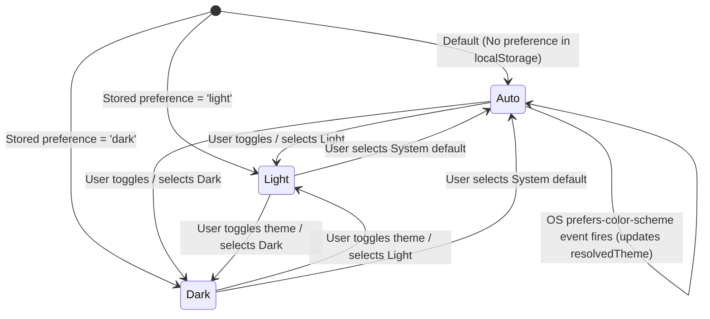

# Data Model & State Architecture: Design Token System & Dynamic Theme Switcher

**Feature Key**: `ARL-4`  
**Feature Slug**: `002-design-token-theme-switcher`  

---

## 1. Domain Types & State Models

```typescript
/**
 * User-configurable theme preferences.
 * - 'light': Always force light theme
 * - 'dark': Always force dark theme
 * - 'auto': Dynamically sync with operating system media query
 */
export type ThemePreference = 'light' | 'dark' | 'auto';

/**
 * Concrete resolved theme applied to the document DOM.
 */
export type ResolvedTheme = 'light' | 'dark';

/**
 * Snapshot of current theme state.
 */
export interface ThemeState {
  theme: ThemePreference;
  resolvedTheme: ResolvedTheme;
  isDark: boolean;
}

/**
 * Public contract exposed by ThemeContext and useTheme() hook.
 */
export interface ThemeContextValue extends ThemeState {
  setTheme: (theme: ThemePreference) => void;
  toggleTheme: () => void;
}
```

---

## 2. Storage Schema & Keys

- **Storage Target**: Browser `localStorage`
- **Key**: `'arlq-theme'`
- **Allowed Values**: `'light' | 'dark' | 'auto'`
- **Fallback / Default**: `'auto'` (resolving to Light by default if OS is undetermined or prefers light)

---

## 3. Toast Data Model

```typescript
export interface ToastItem {
  id: string;
  message: string;
  duration?: number; // Defaults to 2800ms
  timestamp: number;
}

export interface ToastContextValue {
  toasts: ToastItem[];
  showToast: (message: string, duration?: number) => void;
  dismissToast: (id: string) => void;
}
```

---

## 4. Theme Transition State Machine


