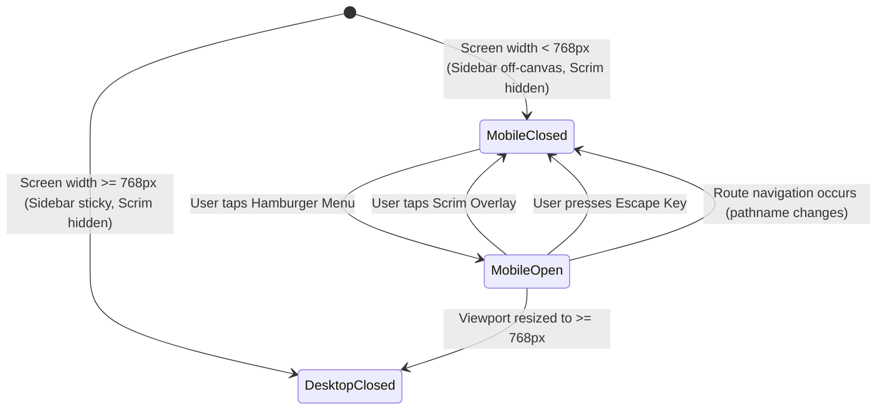

# Data Model & State Architecture: Responsive Layout Shell, Sidebar Navigation & Mobile Scrim

**Feature Key**: `ARL-3`  
**Feature Slug**: `003-responsive-layout-shell`  

---

## 1. Navigation Domain Types & Navigation Hierarchy

```typescript
export interface SubNavItem {
  readonly label: string;
  readonly href: string;
  readonly key: string;
}

export interface NavItem {
  readonly key: string;
  readonly label: string;
  readonly icon: string;
  readonly href: string;
  readonly badgeCount?: number;
  readonly subNav?: readonly SubNavItem[];
}

export interface UserProfileInfo {
  readonly name: string;
  readonly role: string;
  readonly email?: string;
  readonly initials: string;
}
```

---

## 2. Shell Context & UI State Models

```typescript
export interface LayoutContextValue {
  readonly isSidebarOpen: boolean;
  readonly openSidebar: () => void;
  readonly closeSidebar: () => void;
  readonly toggleSidebar: () => void;
  readonly expandedSections: ReadonlySet<string>;
  readonly toggleSection: (sectionKey: string) => void;
}
```

---

## 3. Navigation Canonical Configuration

The canonical navigation items defined in `NAV_CONFIG`:

| Section Key | Section Label | Primary Route | Subnav Items (Label -> Route) |
| :--- | :--- | :--- | :--- |
| `dashboard` | Dashboard | `/dashboard` | _None_ |
| `sales` | Sales | `/sales` | `New sale` -> `/sales/new`<br>`Sales list` -> `/sales` |
| `inventory` | Inventory | `/inventory` | `Stock overview` -> `/inventory`<br>`Stock in` -> `/inventory/in`<br>`Stock out` -> `/inventory/out`<br>`Low stock alerts` -> `/inventory/low`<br>`Movement history` -> `/inventory/history` |
| `products` | Products | `/products` | `Product list` -> `/products`<br>`Categories` -> `/products/categories` |
| `customers` | Customers | `/customers` | `Customer list` -> `/customers`<br>`Customers with balances` -> `/customers/balances` |
| `reports` | Reports | `/reports` | _None_ |
| `settings` | Settings | `/settings` | `Appearance` -> `/settings/appearance` |

---

## 4. Layout Shell State Machine


