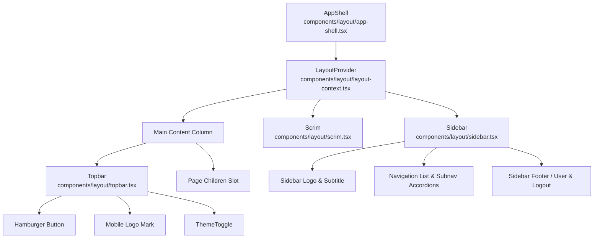

# Implementation Plan: Responsive Layout Shell, Sidebar Navigation & Mobile Scrim

**Feature Key**: `ARL-3`  
**Feature Slug**: `003-responsive-layout-shell`  

---

## 1. Component Hierarchy & Module Boundaries

---

## 2. File Responsibilities

1. `lib/layout/nav-config.ts`:
   - Pure domain constants: `NAV_ITEMS`, route matcher helper `isRouteActive(pathname, href)`, section expansion resolver.
   - Zero React dependencies, completely unit-testable.

2. `components/layout/layout-context.tsx`:
   - React context and hook `useLayout()` managing `isSidebarOpen`, `expandedSections`, `openSidebar()`, `closeSidebar()`, `toggleSidebar()`, `toggleSection()`.
   - Handles route change auto-close and Escape key dismissal.

3. `components/layout/sidebar.tsx`:
   - Semantic `<aside className="sidebar">` matching `mockup/styles.css`.
   - Uses `next/link` for navigation items, SVG icons from `mockup/app.js`.
   - Renders logo header, nav list with expandable submenus, active route highlights, user profile avatar (`Administrator` / `Owner account`), and logout button.

4. `components/layout/topbar.tsx`:
   - Sticky header matching `mockup/styles.css` (`.topbar`).
   - On mobile: displays hamburger menu button, brand logo, and `ThemeToggle`.
   - On desktop: displays `ThemeToggle` aligned right.

5. `components/layout/scrim.tsx`:
   - Overlay backdrop mounted when `isSidebarOpen` is true on mobile.
   - Clicking dispatches `closeSidebar()`.

6. `components/layout/app-shell.tsx`:
   - Wraps `Sidebar`, `Topbar`, `Scrim`, and children in the authenticated shell grid.

7. Route Integration:
   - Provide `app/(admin)/layout.tsx` wrapping all admin modules with `AppShell`.
   - Migrate `/dashboard` and `/settings` into `app/(admin)/dashboard` and `app/(admin)/settings` so all authenticated pages inherit the unified shell without duplicate layout boilerplate.

---

## 3. Test Strategy (TDD)

1. `tests/layout-navigation.test.ts`:
   - Test route matching logic: `/dashboard` matches `/dashboard`, `/sales/new` matches section `/sales` and child `/sales/new`.
   - Test subnav accordion determination: active route automatically expands parent section.
   - Test user profile formatting: initials generation (`Administrator` -> `AD`).
   - Test navigation items contract integrity (all 7 core modules present, correct icons and routes).

2. Verification:
   - `npm test` runs with zero failures.
   - `npx tsc --noEmit` typechecks with zero errors.
   - `npm run lint` passes cleanly.
   - Manual verification with browser devtools across desktop and mobile viewports.
