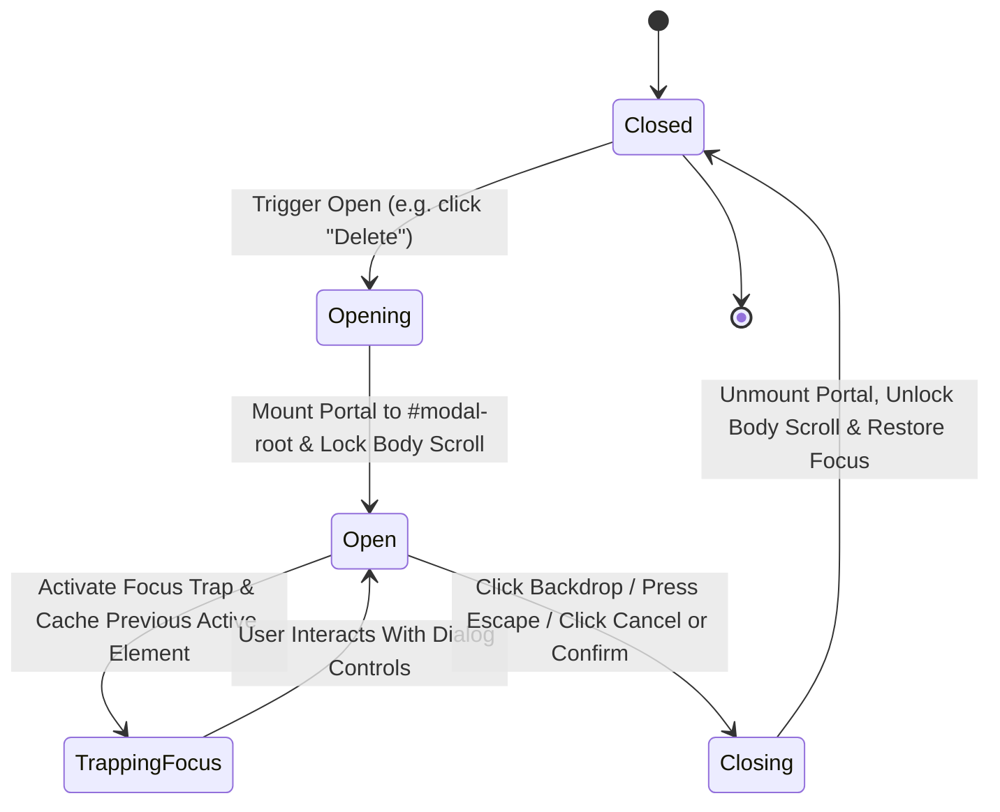
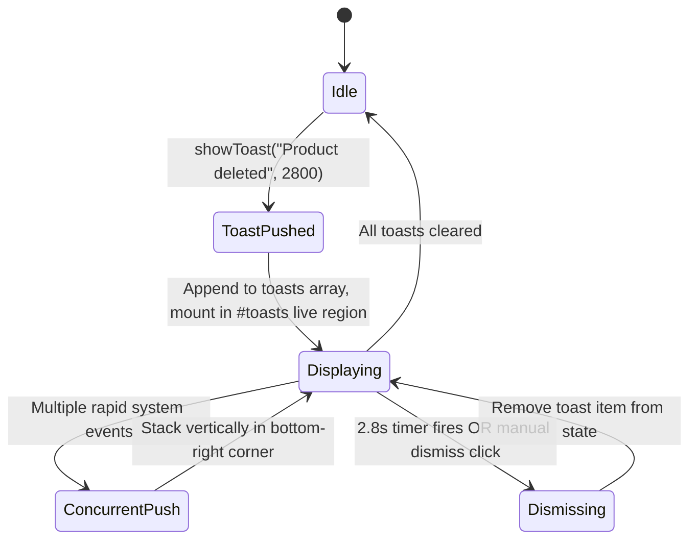

# Data Model & State Architecture: Modal Dialog Root, Confirmations & Toast Notifications

**Feature Key**: `ARL-5`  
**Feature Slug**: `004-modal-dialog-toast-system`  

---

## 1. Domain Entities & Type Definitions

```typescript
// ==========================================
// Toast Notification Domain
// ==========================================

export type ToastVariant = 'success' | 'danger' | 'info' | 'warning';

export interface ToastItem {
  id: string;
  message: string;
  variant?: ToastVariant;
  duration?: number; // In milliseconds, default 2800ms
  createdAt: number;
}

export interface ToastContextValue {
  showToast: (message: string, duration?: number, variant?: ToastVariant) => void;
  dismissToast: (id: string) => void;
  toasts: ToastItem[];
}

// ==========================================
// Modal Dialog Domain
// ==========================================

export interface ModalProps {
  isOpen: boolean;
  onClose: () => void;
  title?: React.ReactNode;
  description?: React.ReactNode;
  children: React.ReactNode;
  footer?: React.ReactNode;
  maxWidth?: 'sm' | 'md' | 'lg' | 'xl';
  closeOnBackdropClick?: boolean;
  closeOnEscape?: boolean;
  initialFocusRef?: React.RefObject<HTMLElement | null>;
  className?: string;
}

// ==========================================
// Confirmation Dialog Domain
// ==========================================

export type ConfirmVariant = 'danger' | 'primary';

export interface ConfirmOptions {
  title: string;
  message: React.ReactNode;
  confirmLabel?: string;
  cancelLabel?: string;
  variant?: ConfirmVariant;
  onConfirm?: () => void | Promise<void>;
  onCancel?: () => void;
}

export interface ConfirmState extends ConfirmOptions {
  isOpen: boolean;
  resolve?: (confirmed: boolean) => void;
}

export interface ConfirmContextValue {
  confirm: (options: ConfirmOptions) => Promise<boolean>;
  closeConfirm: () => void;
}
```

---

## 2. State Machine: Modal Dialog Lifecycle



---

## 3. State Machine: Toast Notification Lifecycle


