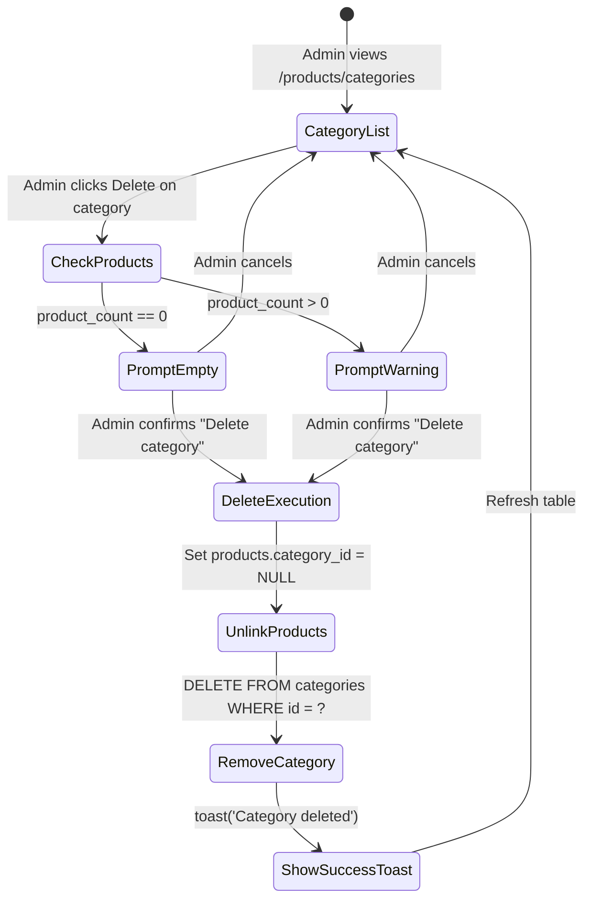

# Data Model & Storage Specifications: Product Category Management with Cascade Validation

**Feature Key**: `ARL-7`  
**Feature Slug**: `005-product-category-management`  

---

## 1. Entities & Domain Models

### Entity: Category
Represents a product classification in the ARLQ condiments inventory.

| Field | Type | Nullable | Default | Description |
| :--- | :--- | :--- | :--- | :--- |
| `id` | `UUID` (string) | No | `gen_random_uuid()` | Unique category identifier |
| `name` | `string` | No | - | Category display name (1–60 chars, trimmed, unique case-insensitive) |
| `created_at` | `string` (ISO-8601) | No | `now()` | Timestamp of category creation |
| `updated_at` | `string` (ISO-8601) | No | `now()` | Timestamp of last modification |

---

### Entity: Product (Reference for Cascade & Count)
Represents a condiment product (Toyo, Suka, Patis) linked to a category.

| Field | Type | Nullable | Default | Description |
| :--- | :--- | :--- | :--- | :--- |
| `id` | `UUID` (string) | No | `gen_random_uuid()` | Unique product identifier |
| `name` | `string` | No | - | Product name (e.g. "Toyo", "Suka", "Patis") |
| `category_id` | `UUID` (string) | **Yes** | `NULL` | Foreign key referencing `categories.id` (`ON DELETE SET NULL`) |
| `created_at` | `string` (ISO-8601) | No | `now()` | Product creation timestamp |

---

### DTO: CategoryWithProductCount
Extended category record augmented with the aggregated count of associated products.

```typescript
export interface CategoryWithProductCount {
  id: string;
  name: string;
  product_count: number;
  created_at: string;
  updated_at: string;
}
```

---

### Input DTOs & Mutation Results

```typescript
export interface CreateCategoryInput {
  name: string;
}

export interface RenameCategoryInput {
  id: string;
  name: string;
}

export interface DeleteCategoryResult {
  success: boolean;
  deletedId: string;
  orphanedProductCount: number;
  error?: string;
}
```

---

## 2. PostgreSQL Schema & Migrations

```sql
-- Migration: 20261105000000_create_categories_table.sql

-- 1. Create categories table
CREATE TABLE IF NOT EXISTS public.categories (
    id UUID PRIMARY KEY DEFAULT gen_random_uuid(),
    name TEXT NOT NULL UNIQUE,
    created_at TIMESTAMPTZ NOT NULL DEFAULT now(),
    updated_at TIMESTAMPTZ NOT NULL DEFAULT now()
);

-- 2. Case-insensitive unique index
CREATE UNIQUE INDEX IF NOT EXISTS categories_name_lower_idx ON public.categories (lower(trim(name)));

-- 3. Row Level Security (RLS)
ALTER TABLE public.categories ENABLE ROW LEVEL SECURITY;

-- Allow authenticated admins to read and write categories
CREATE POLICY "Admins full access to categories"
    ON public.categories
    FOR ALL
    TO authenticated
    USING (true)
    WITH CHECK (true);

-- 4. Initial Seed Categories (from ARLQ physical catalog)
INSERT INTO public.categories (name)
VALUES
    ('Soy Sauce'),
    ('Vinegar'),
    ('Fish Sauce')
ON CONFLICT DO NOTHING;
```

---

## 3. State Machine & Deletion Flow


