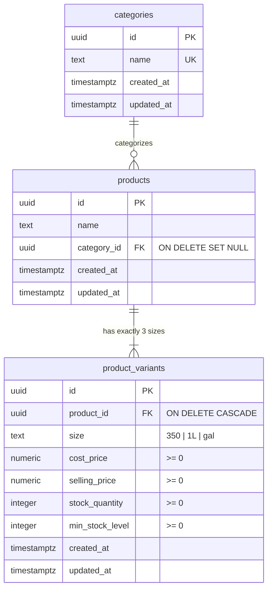

# Data Model & Storage Specifications: Multi-Variant Product Catalog & Pricing Engine

**Feature Key**: `ARL-8`  
**Feature Slug**: `006-multi-variant-product-catalog`  
**Epic**: `EPIC-2: Core Domain Entities & Primary CRUD Operations` (`ARL-6`)  

---

## 1. Entities & Domain Models

### Entity: Product
Represents a parent condiment product (e.g., Toyo, Suka, Patis) linked to a category.

| Field | Type | Nullable | Default | Description |
| :--- | :--- | :--- | :--- | :--- |
| `id` | `UUID` (string) | No | `gen_random_uuid()` | Unique product identifier |
| `name` | `string` | No | - | Product display name (e.g. "Toyo", "Suka", "Patis") |
| `category_id` | `UUID` (string) | **Yes** | `NULL` | Foreign key referencing `categories.id` (`ON DELETE SET NULL`) |
| `created_at` | `string` (ISO-8601) | No | `now()` | Product creation timestamp |
| `updated_at` | `string` (ISO-8601) | No | `now()` | Product last update timestamp |

---

### Entity: ProductVariant
Represents an individual sellable SKU packaging size for a product with pricing, profit tracking, and stock thresholds.

| Field | Type | Nullable | Default | Description |
| :--- | :--- | :--- | :--- | :--- |
| `id` | `UUID` (string) | No | `gen_random_uuid()` | Unique variant identifier |
| `product_id` | `UUID` (string) | No | - | Foreign key referencing `products.id` (`ON DELETE CASCADE`) |
| `size` | `string` (`'350' \| '1L' \| 'gal'`) | No | - | Standard packaging size key |
| `cost_price` | `number` (numeric 10,2) | No | `0.00` | Replenishment/unit production cost in PHP (>= 0) |
| `selling_price` | `number` (numeric 10,2) | No | `0.00` | Retail/wholesale selling price in PHP (>= 0) |
| `stock_quantity` | `number` (integer) | No | `0` | Current on-hand inventory count (>= 0) |
| `min_stock_level` | `number` (integer) | No | `0` | Alert threshold triggering low stock warnings (>= 0) |
| `created_at` | `string` (ISO-8601) | No | `now()` | Variant creation timestamp |
| `updated_at` | `string` (ISO-8601) | No | `now()` | Variant last update timestamp |

**Invariants & Constraints**:
- `CONSTRAINT uq_product_variant_size UNIQUE (product_id, size)`
- `CHECK (cost_price >= 0)`
- `CHECK (selling_price >= 0)`
- `CHECK (stock_quantity >= 0)`
- `CHECK (min_stock_level >= 0)`

---

## 2. Standard Packaging Sizes & Helper Constants

```typescript
export const PRODUCT_SIZES = [
  { key: '350', label: '350 ml' },
  { key: '1L', label: '1 L' },
  { key: 'gal', label: '1 gal' },
] as const;

export type ProductSizeKey = (typeof PRODUCT_SIZES)[number]['key'];
```

---

## 3. DTOs & Domain View Models

### DTO: ProductVariantDTO
```typescript
export interface ProductVariantDTO {
  id: string;
  product_id: string;
  size: ProductSizeKey;
  cost_price: number;
  selling_price: number;
  unit_profit: number; // selling_price - cost_price
  stock_quantity: number;
  min_stock_level: number;
  created_at: string;
  updated_at: string;
}
```

### DTO: ProductWithVariants
Full aggregated view of a product including its associated category and all 3 packaging variants:

```typescript
export interface ProductWithVariants {
  id: string;
  name: string;
  category_id: string | null;
  category_name?: string | null;
  variants: ProductVariantDTO[];
  created_at: string;
  updated_at: string;
}
```

---

## 4. Input & Mutation Types

```typescript
export interface VariantFormInput {
  size: ProductSizeKey;
  cost_price: number;
  selling_price: number;
  min_stock_level: number;
  opening_stock?: number;
}

export interface CreateProductInput {
  name: string;
  category_id?: string | null;
  variants: VariantFormInput[];
}

export interface UpdateProductInput {
  id: string;
  name: string;
  category_id?: string | null;
  variants: VariantFormInput[];
}
```

---

## 5. Relational ER Diagram



