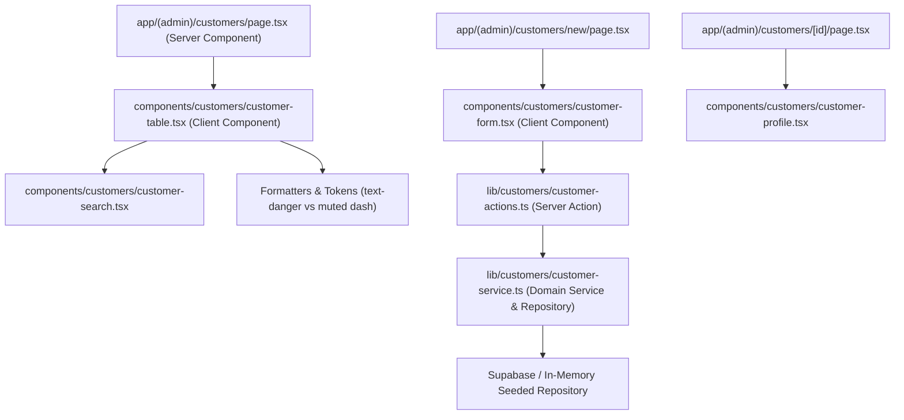

# Technical Implementation Plan: Customer Directory with Contact Book & Balance Rollup

**Feature Key**: `ARL-9`  
**Feature Slug**: `007-customer-directory-balance-rollup`  
**Status**: Ready for Implementation  

---

## 1. Architecture & Component Decomposition

---

## 2. Directory & File Organization

| Path | Purpose |
| :--- | :--- |
| `supabase/migrations/20261105020000_create_customers_and_sales_tables.sql` | Postgres DDL for `customers` and `sales`, indexes, RLS policies, and seed data |
| `lib/customers/customer-contracts.ts` | Zod validation schemas (`customerInputSchema`) and DTO types |
| `lib/customers/customer-service.ts` | Domain repository for customers, search logic, live balance rollup, and formatting |
| `lib/customers/customer-actions.ts` | Next.js Server Actions (`createCustomerAction`, `updateCustomerAction`) |
| `components/customers/customer-table.tsx` | Directory table with instant real-time search, responsive mobile cards, and debt balance pills |
| `components/customers/customer-form.tsx` | Accessible Add/Edit customer form with Zod client validation and toast redirect |
| `components/customers/customer-profile.tsx` | Customer profile overview component displaying contact details, debt card, and transaction history |
| `app/(admin)/customers/page.tsx` | Directory list route |
| `app/(admin)/customers/new/page.tsx` | New customer creation route |
| `app/(admin)/customers/[id]/page.tsx` | Customer profile route |
| `app/(admin)/customers/[id]/edit/page.tsx` | Edit customer route |
| `tests/customers.test.ts` | Unit tests for Zod validation, rollups, formatting, search filtering, and acceptance criteria |

---

## 3. Strict Semantic Design Tokens Mapping

- Balance $> 0$: `text-danger font-semibold` (`var(--bad)`).
- Balance $= 0$: `text-text-muted` (`-`).
- Table Container: `bg-bg-surface border border-border rounded-[var(--r)]`.
- Search Input: `bg-bg-input border border-border focus:border-border-focus text-text-primary`.
- Form Card: `bg-bg-surface border border-border rounded-[var(--r)]`.
- Action Buttons:
  - Add Customer: `bg-primary hover:bg-primary-hover text-text-light`.
  - Cancel / Secondary: `bg-secondary hover:bg-secondary-hover text-text-primary border border-border`.
