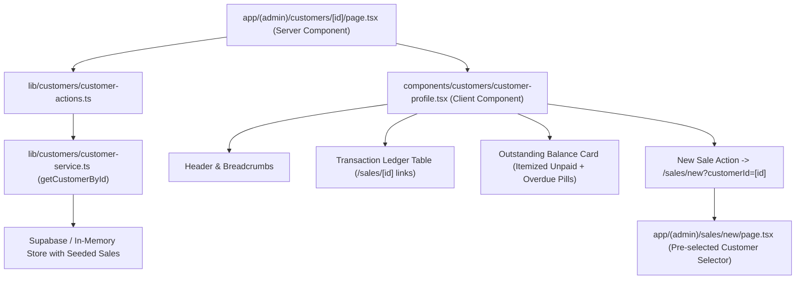

# Technical Implementation Plan: Customer Profile View with Purchase Ledger & Debt Breakdown

**Feature Key**: `ARL-10`  
**Feature Slug**: `008-customer-profile-ledger-debt`  
**Status**: Ready for Implementation  

---

## 1. Architecture & Component Decomposition

---

## 2. Directory & File Plan

| Path | Purpose |
| :--- | :--- |
| `lib/customers/customer-contracts.ts` | Extended TypeScript interfaces for `SaleSummary` with `days_outstanding` and `is_overdue` |
| `lib/customers/customer-service.ts` | Added `getDaysOutstanding`, `isSaleOverdue`, enhanced seed data matching Scenarios 1, 2, 4 |
| `components/customers/customer-profile.tsx` | Updated profile component: overdue badges, itemized unpaid sales links, fully settled display state, links to `/sales/[id]` |
| `app/(admin)/sales/new/page.tsx` | Enhanced New Sale page accepting `customerId` query parameter and rendering customer selector with pre-selected state |
| `tests/customer-profile.test.ts` | Test suite covering all 4 Gherkin scenarios: debt overview, 5 chronological sales, pre-selected new sale, and settled account |

---

## 3. Strict Semantic Design Tokens Mapping

- **Overdue Indicator**: `bg-danger-light text-danger border border-danger-border`
- **Outstanding Debt Number**: `text-[30px] font-bold text-danger` (when $> 0$) vs `text-text-primary` (when $= 0$)
- **Fully Paid Status**: `bg-success-light text-success`
- **Partially Paid / Pending Status**: `bg-accent-light text-accent`
- **Table / Card Surfaces**: `bg-bg-surface border border-border rounded-[var(--r)]`
- **Primary / Action Buttons**: `bg-primary hover:bg-primary-hover text-text-light`
- **Secondary Buttons**: `bg-secondary hover:bg-secondary-hover text-text-primary border border-border`
