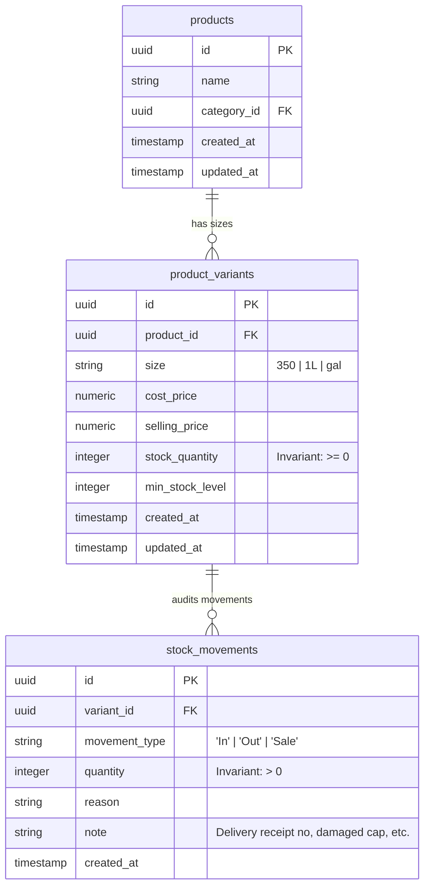
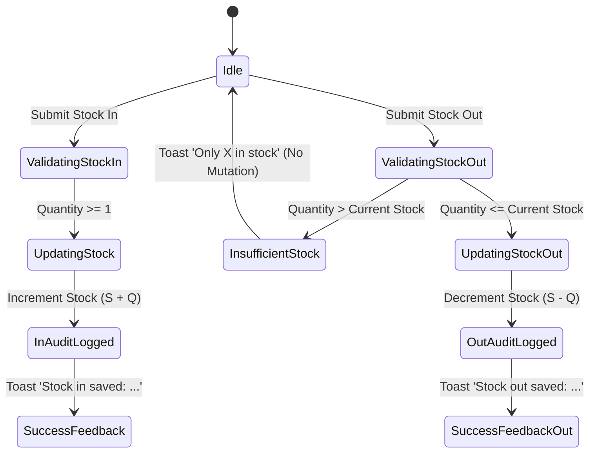

# Data Model: Stock-In & Stock-Out Ledger with Movement Audit

**Feature Key**: `ARL-13`  
**Feature Slug**: `008-stock-movement-ledger`  

---

## 1. Entity Relationship Model



---

## 2. Table Schemas (PostgreSQL / Supabase DDL)

```sql
CREATE TABLE IF NOT EXISTS public.stock_movements (
    id UUID PRIMARY KEY DEFAULT gen_random_uuid(),
    variant_id UUID NOT NULL REFERENCES public.product_variants(id) ON DELETE RESTRICT,
    movement_type TEXT NOT NULL CHECK (movement_type IN ('In', 'Out', 'Sale')),
    quantity INTEGER NOT NULL CHECK (quantity > 0),
    reason TEXT NOT NULL,
    note TEXT NOT NULL DEFAULT '',
    created_at TIMESTAMPTZ NOT NULL DEFAULT now()
);

CREATE INDEX IF NOT EXISTS stock_movements_variant_id_idx 
    ON public.stock_movements (variant_id);

CREATE INDEX IF NOT EXISTS stock_movements_type_idx 
    ON public.stock_movements (movement_type);

CREATE INDEX IF NOT EXISTS stock_movements_created_at_idx 
    ON public.stock_movements (created_at DESC);
```

---

## 3. TypeScript Domain Models & DTOs

```typescript
export type MovementType = 'In' | 'Out' | 'Sale';

export interface StockMovementDTO {
  id: string;
  variant_id: string;
  movement_type: MovementType;
  quantity: number;
  reason: string;
  note: string;
  created_at: string;
  // Hydrated join fields for presentation
  product_name?: string;
  size?: string;
  variant_label?: string;
}

export interface StockMovementWithVariant extends StockMovementDTO {
  product_name: string;
  size: string;
  variant_label: string;
  display_note: string;
  signed_quantity: string; // e.g. "+24" or "-1"
}

export interface RecordMovementInput {
  variant_id: string;
  movement_type: 'In' | 'Out';
  quantity: number;
  reason: string;
  note?: string;
}

export interface MovementActionResult {
  success: boolean;
  movement?: StockMovementDTO;
  new_stock?: number;
  toastMessage?: string;
  error?: string;
  fieldErrors?: Record<string, string[]>;
}
```

---

## 4. State Transitions & Invariants


