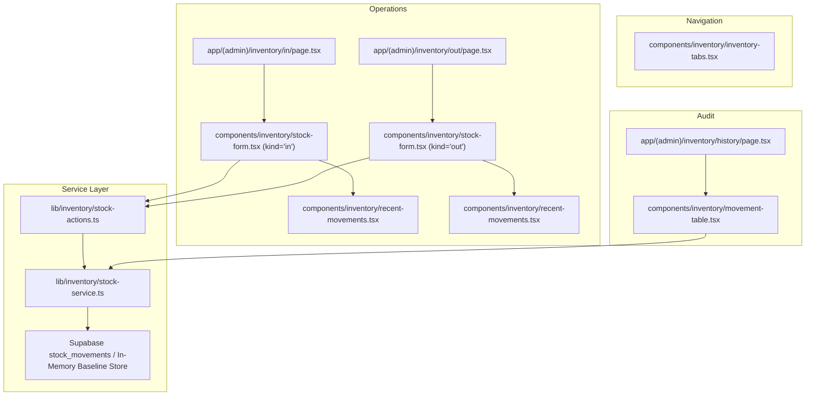

# Technical Implementation Plan: Stock-In & Stock-Out Ledger with Movement Audit

**Feature Key**: `ARL-13`  
**Feature Slug**: `008-stock-movement-ledger`  
**Status**: Ready for Implementation  

---

## 1. Architecture & Component Decomposition

---

## 2. Directory & File Organization

| Path | Purpose |
| :--- | :--- |
| `supabase/migrations/20261105030000_create_stock_movements_table.sql` | Postgres DDL for `stock_movements`, indexes, RLS policies, and seed movements |
| `specs/008-stock-movement-ledger/contracts/stock-contracts.ts` | Zod validation schema, types, toast message formatters, and sign helpers |
| `lib/inventory/stock-contracts.ts` | Export wrapper for contracts matching project conventions |
| `lib/inventory/stock-service.ts` | Domain service handling atomic stock adjustments, history queries, and in-memory store |
| `lib/inventory/stock-actions.ts` | Next.js Server Actions (`recordStockMovementAction`) |
| `components/inventory/inventory-tabs.tsx` | Common sub-navigation tabs (`Overview`, `Stock in`, `Stock out`, `Low stock`, `Movement history`) |
| `components/inventory/stock-form.tsx` | Form for recording Stock In and Stock Out with recent movements card |
| `components/inventory/movement-table.tsx` | Audit table with Type dropdown filter (`All`, `In`, `Out`), real-time search, and badge pills |
| `app/(admin)/inventory/in/page.tsx` | Dedicated Stock In operations page |
| `app/(admin)/inventory/out/page.tsx` | Dedicated Stock Out operations page |
| `app/(admin)/inventory/history/page.tsx` | Movement audit history ledger page |
| `app/(admin)/inventory/page.tsx` | Inventory overview table with links to Stock in / Stock out |
| `tests/stock-movements.test.ts` | Node.js native unit tests covering Scenarios 1, 2, 3, 4, validation, and invariants |

---

## 3. Strict Semantic Design Tokens Mapping

- Stock In Badges: `bg-success-light text-success border border-success-border`
- Stock Out Badges: `bg-accent-light text-accent border border-accent-border`
- Sale Badges: `bg-info-light text-info border border-info-border`
- Signed Quantities: Inbound `+` with `text-success` or bold font, Outbound `-` with `text-accent` or standard bold.
- Split Grid: `.split` CSS grid layout with gap and responsive stacking.
- Primary Action: `bg-primary hover:bg-primary-hover text-text-light`.
- Cancel Action: `bg-secondary hover:bg-secondary-hover text-text-primary border border-border`.
- Form Cards: `bg-bg-surface border border-border rounded-[var(--r)]`.
