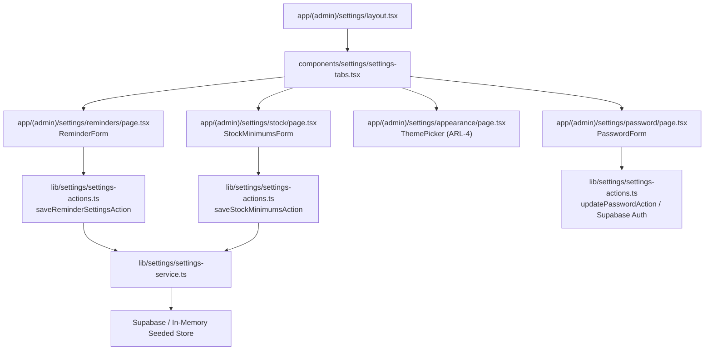

# Technical Implementation Plan: System Settings & Admin Security

**Feature Key**: `ARL-21`  
**Feature Slug**: `008-system-settings-admin-security`  
**Status**: Ready for Implementation  

---

## 1. Architecture & Component Decomposition

---

## 2. Directory & File Organization

| Path | Purpose |
| :--- | :--- |
| `supabase/migrations/20261105030000_create_system_settings_table.sql` | DDL for `system_settings` singleton table with RLS and seed row |
| `lib/settings/settings-contracts.ts` | Zod validation schemas and DTOs |
| `lib/settings/settings-service.ts` | Settings repository (reminders, batch variant minimums, overdue sales calculations) |
| `lib/settings/settings-actions.ts` | Server Actions for reminder settings, stock minimums, and password change |
| `components/settings/settings-tabs.tsx` | Shared tab navigation bar (`Reminder settings`, `Minimum stock levels`, `Appearance`, `Change password`) |
| `components/settings/reminder-settings-form.tsx` | Form for reminder days, admin mobile, channel, and live preview |
| `components/settings/stock-minimums-form.tsx` | 3x3 editable table matrix for product variant minimum stock levels |
| `components/settings/password-form.tsx` | Change password form with client-side length & match validation |
| `app/(admin)/settings/layout.tsx` | Common settings layout providing header, breadcrumbs, and tabs |
| `app/(admin)/settings/page.tsx` | Redirects to `/settings/reminders` |
| `app/(admin)/settings/reminders/page.tsx` | Route for reminder settings tab |
| `app/(admin)/settings/stock/page.tsx` | Route for minimum stock levels tab |
| `app/(admin)/settings/appearance/page.tsx` | Existing appearance page adapted to shared settings layout |
| `app/(admin)/settings/password/page.tsx` | Route for change password tab |
| `tests/settings.test.ts` | Comprehensive unit tests for validation, batch stock updates, and acceptance criteria |

---

## 3. Strict Semantic Design Tokens Mapping

- Card containers: `bg-bg-surface border border-border rounded-xl shadow-xs`.
- Form footer bar: `bg-bg-muted border-t border-border px-5 py-3.5 flex justify-end gap-2.5 rounded-b-xl`.
- Inputs: `bg-bg-input border border-border focus:border-border-focus text-text-primary px-3 py-2 rounded-md`.
- Primary buttons: `bg-primary hover:bg-primary-hover text-text-light font-semibold px-4 py-2 text-sm rounded-md shadow-xs`.
- Preview box: `bg-bg-muted border border-border rounded-lg p-4 text-sm text-text-secondary leading-relaxed`.
- Tab bar: `.tabs` styling with `border-b border-border` and active link indicator `border-primary text-primary`.
