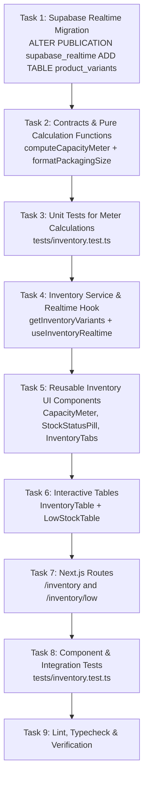

# Implementation Tasks: Live Stock Inventory Monitor & Capacity Level Meters

**Feature Key**: `ARL-12`  
**Feature Slug**: `009-live-stock-inventory-monitor`  
**Jira Story**: STORY-3.1: Live Stock Inventory Monitor & Capacity Level Meters  

---

## Task Matrix & Dependency Order

---

## Detailed Task Breakdown

### Phase 1: Schema & Realtime Infrastructure
- [x] **Task 1**: Create migration `supabase/migrations/20261105030000_enable_realtime_for_product_variants.sql` to add `product_variants` to `supabase_realtime` publication.

### Phase 2: Domain Contracts & Calculation Logic
- [x] **Task 2**: Implement domain contracts and pure evaluation logic:
  - Create `lib/inventory/types.ts` and `lib/inventory/capacity-meter.ts` containing `computeCapacityMeter` and `formatPackagingSize`.
  - Ensure zero hardcoded hex and 100% adherence to design tokens.

### Phase 3: Unit Testing (TDD - Red Phase)
- [x] **Task 3**: Create unit tests in `tests/inventory.test.ts` covering:
  - Out of stock (`stock === 0`) -> meter 0%, status `out-of-stock`, `bad` badge, `isLow = true`.
  - Low stock (`stock <= min`) -> meter percentage calculation, status `low-stock`, `warn` badge, `isLow = true`, accurate `shortBy`.
  - Getting low (`stock <= min * 1.4`) -> status `getting-low`, `warn` badge, `isLow = false`.
  - In stock (`stock > min * 1.4`) -> status `in-stock`, `ok` badge, `isLow = false`.
  - Edge cases: `min = 0`, division by zero safeguards, overflow clamping at 100%.

### Phase 4: Data Service & Realtime Hook
- [x] **Task 4.1**: Implement `getInventoryVariants()` in `lib/services/inventory-service.ts` to fetch joined `product_variants` and `products`.
- [x] **Task 4.2**: Implement `useInventoryRealtime()` hook in `lib/hooks/use-inventory-realtime.ts` to subscribe to Supabase Realtime changes and update state reactively.

### Phase 5: Reusable UI Components
- [x] **Task 5.1**: Implement `CapacityMeter` in `components/inventory/capacity-meter.tsx` matching mockup `.meter` and `.meter.low`.
- [x] **Task 5.2**: Implement `StockStatusPill` in `components/inventory/stock-status-pill.tsx` matching mockup `.pill.ok`, `.pill.warn`, and `.pill.bad`.
- [x] **Task 5.3**: Implement `InventoryTabs` in `components/inventory/inventory-tabs.tsx` supporting sub-navigation for Overview, Stock in, Stock out, Low stock alerts, and Movement history.

### Phase 6: Tables & Page Views
- [x] **Task 6.1**: Implement `InventoryTable` in `components/inventory/inventory-table.tsx` with search input, sorting/filtering, capacity meters, status pills, and action buttons.
- [x] **Task 6.2**: Implement `LowStockTable` in `components/inventory/low-stock-table.tsx` with "Short by" count, danger stock styling, empty state ("Nothing is low"), and settings threshold link.
- [x] **Task 6.3**: Implement page routes:
  - `app/(admin)/inventory/page.tsx`
  - `app/(admin)/inventory/low/page.tsx`

### Phase 7: Verification & Testing
- [x] **Task 7**: Write tests in `tests/inventory.test.ts` verifying:
  - Rendering and retrieval of all 9 items
  - Real-time event updates simulation
  - Low-stock short-by computation and empty state handling
- [x] **Task 8**: Run `npm test`, `npx tsc --noEmit`, and `npm run lint`.
