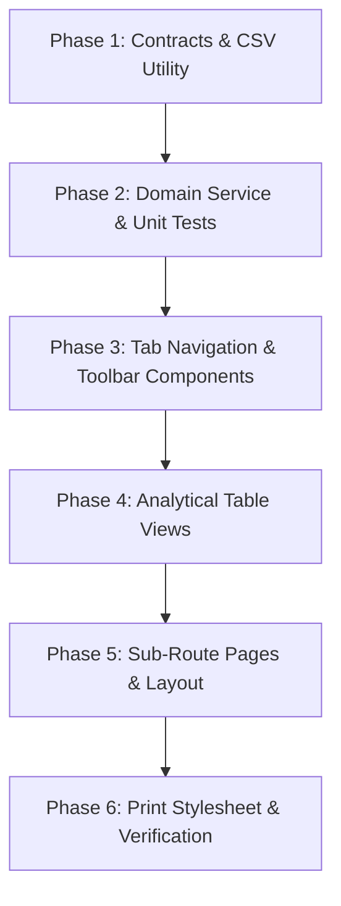

# Implementation Tasks: Multi-Dimensional Tabbed Reporting Suite

**Feature Key**: `ARL-20`  
**Feature Slug**: `013-tabbed-reporting-suite`  
**Jira Story**: STORY-4.3: Multi-Dimensional Tabbed Reporting Suite with CSV/Print Export  

---

## Task Dependencies & Flow

---

## Phase 1: Setup & Domain Contracts

- [x] Task 1.1: Create domain contracts and validation schemas in `lib/reports/report-contracts.ts` (defining `ReportTab`, `ReportPeriod`, `ReportRangeDays`, `ReportFilterState`, and report row DTOs).
- [x] Task 1.2: Implement RFC 4180 compliant CSV serialization and client-side file downloader in `lib/reports/csv-export.ts`.

---

## Phase 2: Domain Math & Aggregation Engine (TDD)

- [x] Task 2.1: Implement pure functional reporting aggregation engine in `lib/reports/report-service.ts` with methods:
  - `filterMatchesVariant(variant, filter)`
  - `aggregateSalesReport(sales, products, variants, filter)`
  - `aggregateInventoryReport(variants, products, filter)`
  - `aggregateMovementReport(movements, variants, products, filter)`
  - `aggregateLowStockReport(variants, products, filter)`
  - `aggregateCustomerBalancesReport(customers, sales)`
  - `aggregateProfitReport(sales, variants, products, filter)`
  - `calculateWeightedMargin(totalProfit, totalRevenue)`
- [x] Task 2.2: Implement comprehensive automated test suite in `tests/reports.test.ts` covering:
  - Scenario 1: Variant profit, revenue, cost, and overall weighted profit margin % calculation.
  - Scenario 2: Dynamic filter toolbar slicing (daily, weekly, monthly periods, product filtering).
  - Scenario 3: Inventory valuation at cost vs selling price and total warehouse valuation.
  - Scenario 4: Stock movement net change calculation across 7, 30, and 90-day windows.
  - Scenario 5: Customer balances sorting and debt summation.
  - Scenario 6: Low stock shortfall calculation and empty state handling.
  - Scenario 7: CSV string generation with proper RFC 4180 quoting and total rows.

---

## Phase 3: Reporting Components & Filter Toolbar

- [x] Task 3.1: Create responsive tab navigation bar `components/reports/report-tabs.tsx` conforming to mockup design with active state indicators.
- [x] Task 3.2: Create dynamic filter toolbar `components/reports/report-toolbar.tsx` supporting period selector, date range selector, product dropdown, size dropdown, "Export CSV", and "Print report" buttons.

---

## Phase 4: Analytical Table Views

- [x] Task 4.1: Implement `components/reports/sales-report-view.tsx` rendering period buckets, transactions, bottles sold, sales revenue, profit, and summary footer.
- [x] Task 4.2: Implement `components/reports/inventory-report-view.tsx` rendering variant cost valuation, selling price valuation, and warehouse inventory totals.
- [x] Task 4.3: Implement `components/reports/movement-report-view.tsx` rendering stock-in, stock-out, net change, and current stock on hand.
- [x] Task 4.4: Implement `components/reports/low-stock-report-view.tsx` rendering low-stock alerts, shortfalls, and empty state.
- [x] Task 4.5: Implement `components/reports/balances-report-view.tsx` rendering customer unpaid sales and outstanding debt balances.
- [x] Task 4.6: Implement `components/reports/profit-report-view.tsx` rendering bottles sold, revenue, cost, profit, and variant margins with weighted footer percentage.

---

## Phase 5: App Router Layout & Sub-Routes

- [x] Task 5.1: Create `app/(admin)/reports/layout.tsx` rendering header title, subtitle, breadcrumbs, back to dashboard button, and `ReportTabs`.
- [x] Task 5.2: Update `app/(admin)/reports/page.tsx` to redirect cleanly to `/reports/sales`.
- [x] Task 5.3: Implement `app/(admin)/reports/sales/page.tsx`.
- [x] Task 5.4: Implement `app/(admin)/reports/inventory/page.tsx`.
- [x] Task 5.5: Implement `app/(admin)/reports/movement/page.tsx`.
- [x] Task 5.6: Implement `app/(admin)/reports/low/page.tsx`.
- [x] Task 5.7: Implement `app/(admin)/reports/balances/page.tsx`.
- [x] Task 5.8: Implement `app/(admin)/reports/profit/page.tsx`.

---

## Phase 6: Print Optimization & Final Convergence

- [x] Task 6.1: Verify and refine print stylesheet in `app/globals.css` ensuring clean print layout without sidebar, header, tabs, or toolbar.
- [x] Task 6.2: Execute full test suite `npm test` and build check `npm run build`.
