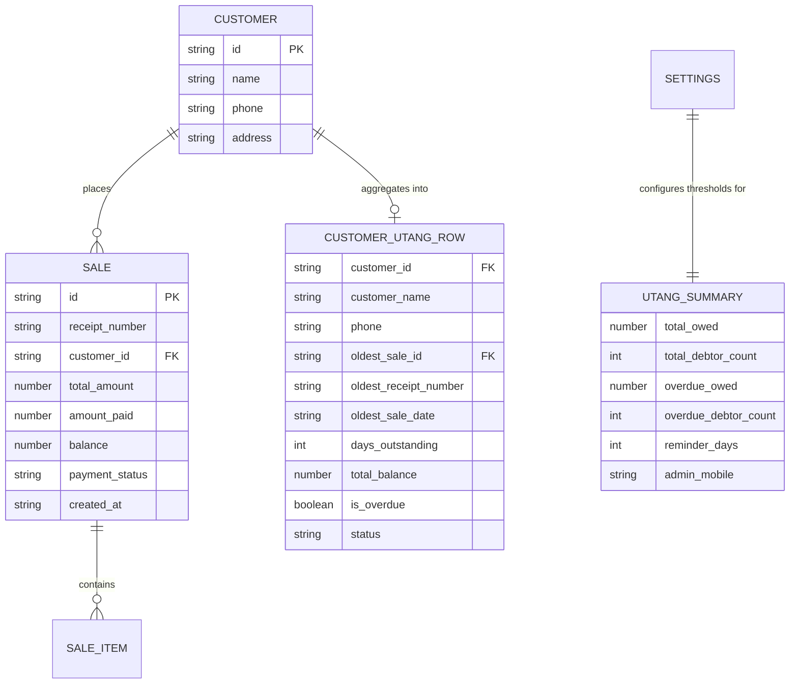

# Data Model: Customer Utang (Credit Balance) Tracker & Overdue Reminder Queue

**Feature Key**: `ARL-19`  
**Feature Slug**: `014-customer-utang-tracker-reminder-queue`  

---

## 1. Domain Entities & Type Definitions



---

## 2. TypeScript Data Transfer Objects (DTOs)

```typescript
export type DebtStatus = 'Overdue' | 'Not yet due';

export interface CustomerUtangRowDTO {
  customer_id: string;
  customer_name: string;
  phone: string;
  oldest_sale_id: string;
  oldest_receipt_number: string;
  oldest_sale_date: string;
  days_outstanding: number;
  total_balance: number;
  is_overdue: boolean;
  status: DebtStatus;
}

export interface CustomerUtangSummaryDTO {
  rows: CustomerUtangRowDTO[];
  total_owed: number;
  total_debtors: number;
  overdue_owed: number;
  overdue_debtors: number;
  reminder_days: number;
  admin_mobile: string;
}
```

---

## 3. Aging & Ranking Logic Specification

1. **Filtering**:
   $$\text{debtor\_sales}(c) = \{ s \in \text{Sales} \mid s.\text{customer\_id} = c.\text{id} \land s.\text{balance} > 0 \}$$
   A customer $c$ is a debtor if and only if $\text{debtor\_sales}(c) \neq \emptyset$.

2. **Total Balance Rollup**:
   $$\text{total\_balance}(c) = \sum_{s \in \text{debtor\_sales}(c)} s.\text{balance}$$

3. **Oldest Unpaid Sale Determination**:
   $$\text{oldest\_sale}(c) = \arg\max_{s \in \text{debtor\_sales}(c)} (\text{days\_outstanding}(s.\text{created\_at}, \text{asOf}))$$
   $$\text{days\_outstanding}(c) = \text{days\_outstanding}(\text{oldest\_sale}(c).\text{created\_at}, \text{asOf})$$

4. **Debt Age Sorting (Descending)**:
   $$\text{Comparator}(c_1, c_2):$$
   $$\begin{cases}
     c_2.\text{days\_outstanding} - c_1.\text{days\_outstanding} & \text{if } c_1.\text{days\_outstanding} \neq c_2.\text{days\_outstanding} \\
     c_2.\text{total\_balance} - c_1.\text{total\_balance} & \text{otherwise}
   \end{cases}$$

5. **Overdue Classification**:
   $$\text{status}(c) = \begin{cases}
     \text{"Overdue"} & \text{if } \text{days\_outstanding}(c) \ge \text{reminder\_days} \\
     \text{"Not yet due"} & \text{otherwise}
   \end{cases}$$
