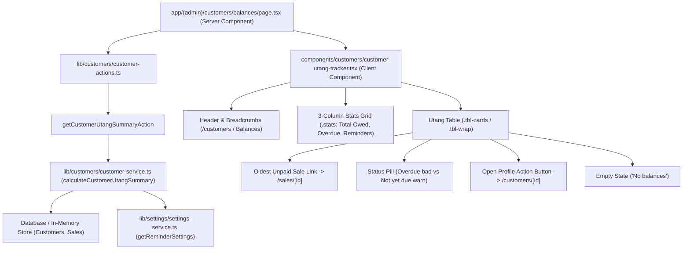

# Technical Implementation Plan: Customer Utang (Credit Balance) Tracker & Overdue Reminder Queue

**Feature Key**: `ARL-19`  
**Feature Slug**: `014-customer-utang-tracker-reminder-queue`  
**Status**: Ready for Implementation  

---

## 1. Architecture & Component Decomposition

---

## 2. Directory & File Plan

| Path | Purpose |
| :--- | :--- |
| `lib/customers/customer-contracts.ts` | Extends contracts with `CustomerUtangRowDTO`, `CustomerUtangSummaryDTO`, and `DebtStatus` |
| `lib/customers/customer-service.ts` | Implements `calculateCustomerUtangSummary()` function, aging calculation, sorting descending by oldest unpaid sale, and seeding |
| `lib/customers/customer-actions.ts` | Adds Server Action `getCustomerUtangSummaryAction()` callable by Server Components and Client Components |
| `components/customers/customer-utang-tracker.tsx` | Interactive UI component rendering header, 3-column stats cards, utang table, overdue badges, empty state, and links |
| `app/(admin)/customers/balances/page.tsx` | Replaces the placeholder page with live Server Component integrating `getCustomerUtangSummaryAction()` |
| `tests/customer-utang-tracker.test.ts` | Complete test suite verifying all 6 Gherkin scenarios (sorting by age, overdue pill, not yet due pill, direct links, empty state) |

---

## 3. Strict Semantic Design Tokens Mapping

- **Overdue Status Badge**: `pill bad` / `bg-danger-light text-danger border border-danger-border`
- **Not Yet Due Status Badge**: `pill warn` / `bg-accent-light text-accent border border-accent-border`
- **Overdue Stat Card Highlight**: `.stat.alert b` / `text-danger`
- **Surfaces**: `bg-bg-surface border border-border rounded-[var(--r)]`
- **Secondary Action Button**: `btn sec sm` (`bg-secondary hover:bg-secondary-hover text-text-primary border border-border`)
- **Table Card Headers / Text**: `text-text-primary`, `text-text-secondary`, `text-text-muted`
- **Receipt Link**: `text-primary hover:underline font-semibold`
