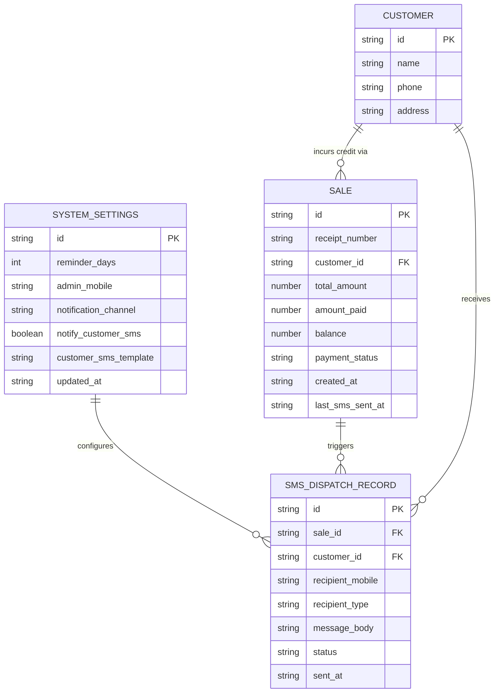

# Data Model: Dual SMS Overdue Balance Reminders (ARL-22)

**Feature Key**: `ARL-22`  
**Feature Slug**: `015-dual-sms-overdue-balance-reminders`  
**Jira Story**: STORY-4.5: Dual SMS Overdue Balance Reminders for Admin & Customer with Manual Nudge and Settings Toggle  

---

## 1. Domain Entities & Entity Relationships



---

## 2. TypeScript Data Transfer Objects (DTOs) & Contracts

### 2.1 System Settings Extension
```typescript
export interface SystemSettingsDTO {
  id: string;
  reminder_days: number;
  admin_mobile: string;
  notification_channel: string;
  notify_customer_sms: boolean;
  customer_sms_template?: string | null;
  updated_at: string;
}

export interface ReminderSettingsInput {
  reminder_days: number;
  admin_mobile: string;
  notification_channel: 'SMS';
  notify_customer_sms: boolean;
  customer_sms_template?: string | null;
}
```

### 2.2 SMS Dispatch Types
```typescript
export type SmsRecipientType = 'ADMIN' | 'CUSTOMER';

export interface SmsDispatchPayload {
  recipientMobile: string;
  recipientType: SmsRecipientType;
  message: string;
  saleId?: string;
  receiptNumber?: string;
  customerId?: string;
  customerName?: string;
}

export interface SmsDispatchResult {
  success: boolean;
  messageId?: string;
  recipientMobile: string;
  recipientType: SmsRecipientType;
  timestamp: string;
  error?: string;
}

export interface ManualSmsNudgeInput {
  saleId?: string;
  customerId?: string;
}

export interface OverdueSweepResult {
  salesEvaluated: number;
  adminSmsDispatched: number;
  customerSmsDispatched: number;
  customerSmsSkipped: number;
  details: Array<{
    saleId: string;
    receiptNumber: string;
    adminSuccess: boolean;
    customerSuccess?: boolean;
    customerSkippedReason?: string;
  }>;
}
```

---

## 3. Storage & Schema Migration

```sql
-- Migration: Add customer SMS reminder toggle and audit timestamp
ALTER TABLE public.system_settings 
  ADD COLUMN IF NOT EXISTS notify_customer_sms BOOLEAN NOT NULL DEFAULT false,
  ADD COLUMN IF NOT EXISTS customer_sms_template TEXT NULL;

ALTER TABLE public.sales
  ADD COLUMN IF NOT EXISTS last_sms_sent_at TIMESTAMPTZ NULL;
```

