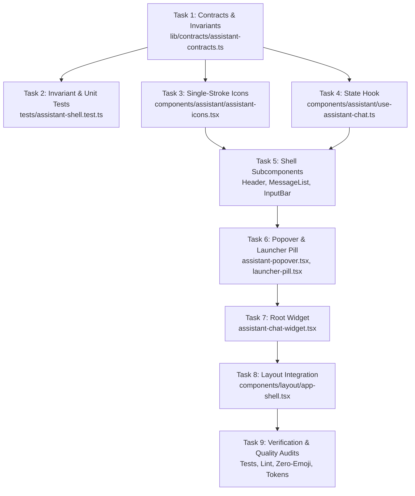

# Implementation Tasks: Floating Launcher & Minimalist Lower-Right Chat Shell

**Feature Key**: `ARL-30`  
**Feature Slug**: `016-floating-launcher-chat-shell`  

---

## Task Matrix & Dependency Order

---

## Detailed Task Specifications

### Phase 1: Data Contracts & Invariants

- [x] **Task 1: Core Domain Contracts & Zero-Emoji Invariant**
  - **File**: `lib/assistant/assistant-contracts.ts`
  - Define `ChatMessage`, `ChatRole`, `AssistantStatus`, `AssistantShellState`.
  - Implement `containsEmoji(text: string): boolean` regex validator.
  - Implement `createChatMessage` factory enforcing zero-emoji rule.
  - Export `DEFAULT_WELCOME_MESSAGE = 'Ask questions about store inventory, sales, customer utang balances, or pricing.'`.
  - Export `LAUNCHER_LABEL = 'Store Assistant'`.

- [x] **Task 2: Unit & Invariant Test Suite**
  - **File**: `tests/assistant-shell.test.ts`
  - Test Zod validation for valid and invalid messages.
  - Test `containsEmoji` detector across emojis, symbols, and alphanumeric strings.
  - Test `createChatMessage` throws when given emoji strings and succeeds for valid text.
  - Test message ordering, role classification, and clear reset invariants.

### Phase 2: Icons & State Management

- [x] **Task 3: Single-Stroke Iconography**
  - **File**: `components/assistant/assistant-icons.tsx`
  - Restrained SVG icons with `stroke="currentColor"`, `strokeWidth="1.8"`, `fill="none"`:
    - `MessageSquareIcon` (for launcher pill)
    - `SendIcon` (for submit button)
    - `CloseIcon` (`×`)
    - `MinimizeIcon` (`−`)
    - `ClearIcon` (clean trash/eraser stroke)

- [x] **Task 4: Assistant Client Hook & State Machine**
  - **File**: `components/assistant/use-assistant-chat.ts`
  - Implement `useAssistantChat` hook:
    - `isOpen`, `setIsOpen`, `toggleOpen`
    - `messages`, `sendMessage`, `clearMessages`
    - `inputValue`, `setInputValue`
    - `status` (`'idle' | 'loading' | 'error'`)
    - Persistence with `sessionStorage` (`arlq_assistant_messages`, `arlq_assistant_open`) with safe SSR fallback.

### Phase 3: Shell Components

- [x] **Task 5: Header, Message Stream & Input Bar Components**
  - **Files**:
    - `components/assistant/assistant-header.tsx`: Title ("Store Assistant"), active status dot, "Clear" button, minimize/close toggle.
    - `components/assistant/assistant-message-list.tsx`: Scrollable turn container with auto-scroll to bottom, welcome state, user/assistant bubble styles.
    - `components/assistant/assistant-input-bar.tsx`: Auto-resizing input/textarea, `Enter`/`Shift+Enter` listeners, character validation, and single-stroke send action.

- [x] **Task 6: Popover Container & Launcher Pill**
  - **Files**:
    - `components/assistant/assistant-launcher-pill.tsx`: Fixed lower-right pill button with status dot, icon, and label.
    - `components/assistant/assistant-popover.tsx`: Anchored window (~380px wide, ~520px high, responsive on mobile) with slot for ARL-31 suggested questions.

- [x] **Task 7: Root Widget Component**
  - **File**: `components/assistant/assistant-chat-widget.tsx`
  - Coordinated container rendering launcher pill or expanded popover.
  - Global `Esc` key listener to collapse the shell.
  - Focus restoration to launcher pill upon closing.

### Phase 4: Integration & Verification

- [x] **Task 8: AppShell Integration**
  - **File**: `components/layout/app-shell.tsx`
  - Render `<AssistantChatWidget />` inside `AppShell` so it floats seamlessly across all admin pages.

- [x] **Task 9: Verification & Quality Audits**
  - Run `npm test` inside `.worktrees/ARL-30`.
  - Audit for zero hardcoded hex values and zero emoji characters.
  - Run TypeScript compilation checks (`tsc --noEmit`).
