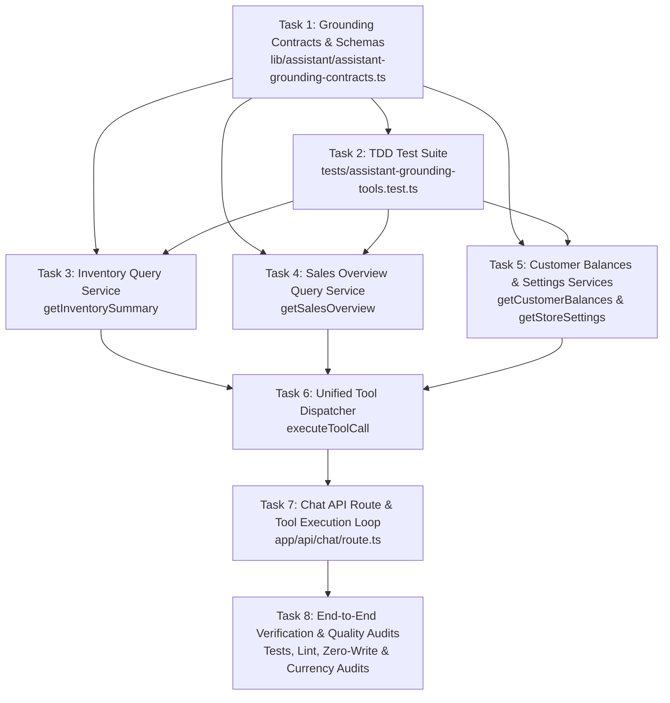

# Implementation Tasks: Read-Only Database Grounding Tools

**Feature Key**: `ARL-32`  
**Feature Slug**: `017-read-only-database-grounding-tools`  
**Parent Epic**: `ARL-29` (In-App AI Operational Assistant)  

---

## Task Matrix & Dependency Order

---

## Detailed Task Specifications

### Phase 1: Data Contracts & Test Suite (Red)

- [ ] **Task 1: Core Grounding Contracts & Gemini Tool Declarations**
  - **File**: `lib/assistant/assistant-grounding-contracts.ts`
  - Define Zod schemas and TypeScript types for:
    - `InventorySummaryInputSchema`, `InventorySummaryResultSchema`
    - `SalesOverviewInputSchema`, `SalesOverviewResultSchema`, `SalesTimeframeSchema`
    - `CustomerBalancesInputSchema`, `CustomerBalancesResultSchema`
    - `StoreSettingsInputSchema`, `StoreSettingsResultSchema`
  - Implement helper formatters:
    - `formatPhilippinePeso(amount: number): string` (e.g. `₱1,250.00`)
    - `formatPackagingSize(rawSize: string): PackagingSize` (`350 ml`, `1 L`, `1 gal`)
  - Export `ASSISTANT_TOOL_DECLARATIONS` conforming to the Gemini function declaration format.

- [ ] **Task 2: Grounding Tools Unit & Acceptance Test Suite**
  - **File**: `tests/assistant-grounding-tools.test.ts`
  - Write tests for:
    - Zod schemas validating valid inputs and rejecting illegal types / missing required fields.
    - Currency formatter producing `₱` with commas and 2 decimals.
    - Packaging size normalizer mapping `350`, `1L`, `gal` to standard labels.
    - `getInventorySummary` filtering by low stock (`lowStockOnly`), condiment search (`searchQuery`), and handling non-existent items ("Mang Tomas").
    - `getSalesOverview` time window calculations in Manila timezone (`today`, `yesterday`, `last_7_days`, `current_month`, `all`).
    - `getCustomerBalances` filtering indebted accounts and overdue items (`overdueOnly`).
    - `getStoreSettings` fetching operational configuration.
    - `executeToolCall` dispatcher delegating to tool functions and catching errors.
    - Absolute read-only boundary assertion: zero write tools exposed.

### Phase 2: Query Services Implementation (Green)

- [ ] **Task 3: `getInventorySummary` Query Service**
  - **File**: `lib/assistant/assistant-tools.ts`
  - Query `products` joined with `product_variants` and `categories` (or `ProductService` fallback).
  - Compare `stock_quantity <= min_stock_level` for `isLowStock` flag.
  - Compute `totalVariants` and `lowStockCount`.
  - Format prices with `formatPhilippinePeso` and sizes with `formatPackagingSize`.

- [ ] **Task 4: `getSalesOverview` Query Service**
  - **File**: `lib/assistant/assistant-tools.ts`
  - Query `sales` table (or `SaleService` fallback) with timestamp boundaries in `Asia/Manila` timezone.
  - Calculate `totalSalesCount`, `totalGrossRevenue`, `totalCashCollected`, and `totalOutstandingBalance`.
  - Calculate `paymentBreakdown` (`paidCount`, `partiallyPaidCount`, `notPaidCount`).

- [ ] **Task 5: `getCustomerBalances` and `getStoreSettings` Query Services**
  - **File**: `lib/assistant/assistant-tools.ts`
  - `getCustomerBalances`: join customers and sales with positive balances, calculate `oldestUnpaidDays` and `isOverdue` against threshold.
  - `getStoreSettings`: return default reminder threshold, store phone, and metadata.

- [ ] **Task 6: Unified Tool Call Dispatcher**
  - **File**: `lib/assistant/assistant-tools.ts`
  - Implement `executeToolCall(name: AssistantToolName, args: unknown, supabase?: SupabaseClient | null)`.
  - Validate parameters against corresponding Zod schemas.
  - Return JSON-serializable payloads for model consumption.

### Phase 3: Chat API Route & Tool Execution Loop

- [ ] **Task 7: Chat API Route with Gemini Function Calling & Grounded Response Loop**
  - **File**: `app/api/chat/route.ts`
  - Implement `POST` handler for chat messages.
  - Pass `ASSISTANT_TOOL_DECLARATIONS` to Gemini Flash model.
  - When model emits a `functionCall`, invoke `executeToolCall` and submit `functionResponse` back to model in a loop.
  - Provide fallback behavior when no API key is configured.

### Phase 4: Integration, Verification & Quality Audits

- [ ] **Task 8: End-to-End Verification & Quality Audits**
  - Run full test suite: `npm test`.
  - Verify all 5 acceptance criteria Gherkin scenarios pass.
  - Run `npm run lint` and TypeScript check (`npx tsc --noEmit`).
  - Verify zero emojis across all responses and outputs.
  - Verify zero write mutations in database grounding layer.
