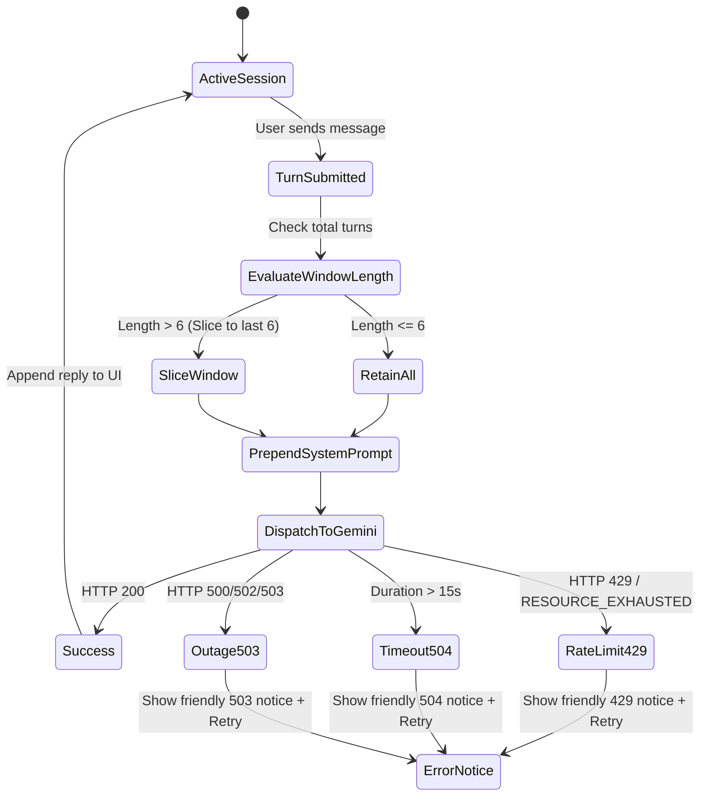

# Data Model & State Architecture: Gemini Free-Tier Resilience

**Feature Key**: `ARL-34`  
**Feature Slug**: `020-gemini-free-tier-resilience`  

---

## 1. Resilience Domain Types & Error Entities

```typescript
/**
 * Known failure categories when interacting with Gemini API
 */
export type GeminiFailureReason =
  | 'MISSING_API_KEY'
  | 'RATE_LIMIT_EXCEEDED'
  | 'TIMEOUT'
  | 'UPSTREAM_OUTAGE'
  | 'UNKNOWN_ERROR';

/**
 * Mapped API Error Response
 */
export interface AssistantErrorResponse {
  error: string;
  code?: GeminiFailureReason;
  status: number;
}

/**
 * Message history element for conversation pruning
 */
export interface ConversationMessageTurn {
  role: 'user' | 'assistant' | 'system';
  content: string;
}
```

---

## 2. Sliding Window State Machine



---

## 3. Client-Side Assistant State Transitions

```typescript
export type AssistantStatus = 'idle' | 'loading' | 'error';

export interface AssistantState {
  isOpen: boolean;
  status: AssistantStatus;
  messages: ChatMessage[];
  inputValue: string;
  lastFailedMessage: string | null;
}
```

- When user submits message: `status = 'loading'`, `inputValue = ''`, `lastFailedMessage = null`.
- On success: `status = 'idle'`.
- On failure (HTTP >= 400 or network error):
  - `status = 'error'`
  - `lastFailedMessage = messageContent`
  - Inline error notice rendered with `Retry` action calling `sendMessage(lastFailedMessage)`.
- When user clicks `Retry`:
  - `status = 'loading'`
  - Submits `lastFailedMessage` again.
