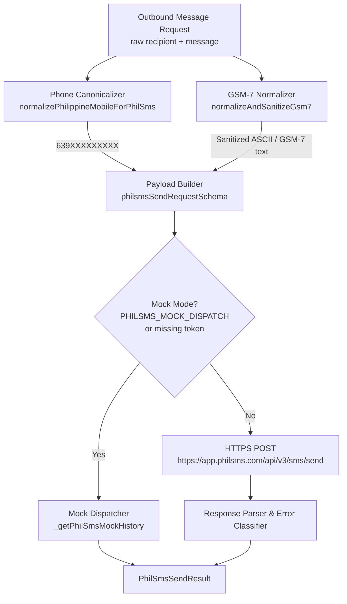

# Data Model: PhilSMS Gateway Adapter & GSM-7 Telecom Normalizer (ARL-24)

**Feature Key**: `ARL-24`  
**Feature Slug**: `021-philsms-gateway-adapter`  
**Jira Story**: STORY-5.1: PhilSMS Gateway Adapter, Environment Secret Configuration & GSM-7 Payload Encoder  

---

## 1. Gateway Data Flow & Architecture



---

## 2. TypeScript Interfaces & Schemas

### 2.1 Error Codes
```typescript
export type PhilSmsErrorCode =
  | 'INVALID_RECIPIENT_MOBILE'
  | 'GATEWAY_BAD_REQUEST'
  | 'GATEWAY_AUTH_ERROR'
  | 'INSUFFICIENT_CREDITS'
  | 'GATEWAY_RATE_LIMITED'
  | 'NETWORK_UNREACHABLE'
  | 'GATEWAY_UNKNOWN_ERROR';
```

### 2.2 GSM-7 Encoding Diagnostic Model
```typescript
export interface Gsm7EncodingSummary {
  encoding: 'GSM-7' | 'UCS-2';
  characterCount: number;
  segmentCount: number;
  estimatedCredits: number;
  hasNonGsmCharacters: boolean;
  nonGsmCharacters?: string[];
}
```

### 2.3 PhilSMS v3 Request & Response Contracts
```typescript
export interface PhilSmsSendRequest {
  recipient: string; // "639XXXXXXXXX"
  sender_id: string; // e.g. "PhilSMS" or approved ID
  type: 'plain';
  message: string;
}

export interface PhilSmsSuccessData {
  uid: string;
  to: string;
  message: string;
  cost?: number;
  status: string;
}

export interface PhilSmsApiResponse {
  status: 'success' | 'error';
  message?: string;
  data?: PhilSmsSuccessData;
}
```

### 2.4 Adapter High-Level Options & Dispatch Result
```typescript
export interface PhilSmsSendOptions {
  recipient: string;
  message: string;
  senderId?: string;
  bypassNormalization?: boolean;
}

export interface PhilSmsSendResult {
  success: boolean;
  messageId?: string;
  recipient: string;
  senderId: string;
  cost?: number;
  encoding: 'GSM-7' | 'UCS-2';
  segments: number;
  errorCode?: PhilSmsErrorCode;
  errorMessage?: string;
  rawResponse?: unknown;
}
```

### 2.5 In-Memory Mock Audit Record
```typescript
export interface PhilSmsMockRecord {
  id: string;
  recipient: string;
  senderId: string;
  message: string;
  timestamp: string;
  encoding: 'GSM-7' | 'UCS-2';
  segments: number;
}
```
