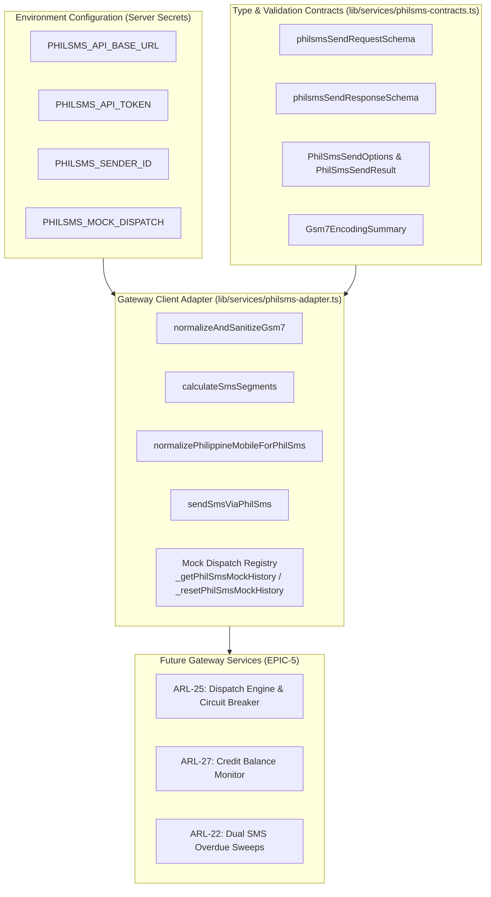

# Technical Implementation Plan: PhilSMS Gateway Adapter (ARL-24)

**Feature Key**: `ARL-24`  
**Feature Slug**: `021-philsms-gateway-adapter`  
**Jira Story**: STORY-5.1: PhilSMS Gateway Adapter, Environment Secret Configuration & GSM-7 Payload Encoder  
**Epic**: EPIC-5: Production SMS Gateway Infrastructure & Telecom Delivery (PhilSMS) (`ARL-23`)  

---

## 1. Architectural Blueprint & Layer Boundaries

---

## 2. File Deliverables & Touchpoints

1. **`lib/services/philsms-contracts.ts`**:
   - Complete Zod schemas: `philsmsSendRequestSchema`, `philsmsSendResponseSchema`, `philsmsCanonicalMobileSchema`.
   - TypeScript interfaces: `PhilSmsSendOptions`, `PhilSmsSendResult`, `PhilSmsErrorCode`, `Gsm7EncodingSummary`, `PhilSmsMockRecord`.
   - Encoding constants: GSM-7 base and extension character sets, segment boundaries (160 / 153 for GSM-7, 70 / 67 for UCS-2).

2. **`lib/services/philsms-adapter.ts`**:
   - `normalizePhilippineMobileForPhilSms(mobile: string): string` (formats to `639XXXXXXXXX`).
   - `normalizeAndSanitizeGsm7(text: string): string` (replaces `₱` with `PHP `, curly quotes with ASCII, em/en-dashes with hyphens, trims whitespace).
   - `calculateSmsSegments(text: string): Gsm7EncodingSummary` (calculates character count, detects non-GSM-7 characters, computes segment count and credit cost).
   - `sendSmsViaPhilSms(options: PhilSmsSendOptions): Promise<PhilSmsSendResult>` (executes live HTTPS POST or falls back to offline mock mode).
   - Mock history helpers: `_getPhilSmsMockHistory()`, `_resetPhilSmsMockHistory()`.

3. **`.env.example`**:
   - Add PhilSMS server-side configuration documentation:
     - `PHILSMS_API_BASE_URL`
     - `PHILSMS_API_TOKEN`
     - `PHILSMS_SENDER_ID`
     - `PHILSMS_MOCK_DISPATCH`

4. **`tests/unit/philsms-adapter.test.ts`**:
   - 100% test coverage of phone normalization matrix (valid/invalid formats, prefix stripping, whitespace).
   - 100% test coverage of GSM-7 sanitization (Peso replacement, typographic quote conversion, dashes).
   - Character count and segment calculator accuracy for 1 segment, concatenated multi-part, and UCS-2 fallbacks.
   - Live HTTP payload structure validation (via mocked fetch).
   - Error handling for HTTP 400, 401, 402, 422, 429, and network timeouts.
   - Offline mock mode verification (records to in-memory history, returns synthetic `mock_philsms_` IDs).

---

## 3. Security & Architecture Checklist

- [x] Server-side secret isolation: No secrets prefixed with `NEXT_PUBLIC_`.
- [x] Zero browser runtime leakage: Code remains in server services.
- [x] Telecom credit conservation: Automated replacement of `₱` prevents 70-character UCS-2 penalties.
- [x] Strict TypeScript: Zero `any` types, exact error code union, full Zod runtime validations.

---

## 4. Test Strategy

- Node.js native test runner (`node --test`).
- Mock global `fetch` using Node's test mocking capabilities (`mock.method(globalThis, 'fetch', ...)`) to simulate HTTP responses and verify request headers/body.
- In-memory mock tests ensuring test runs execute completely offline and never consume live carrier credits.
