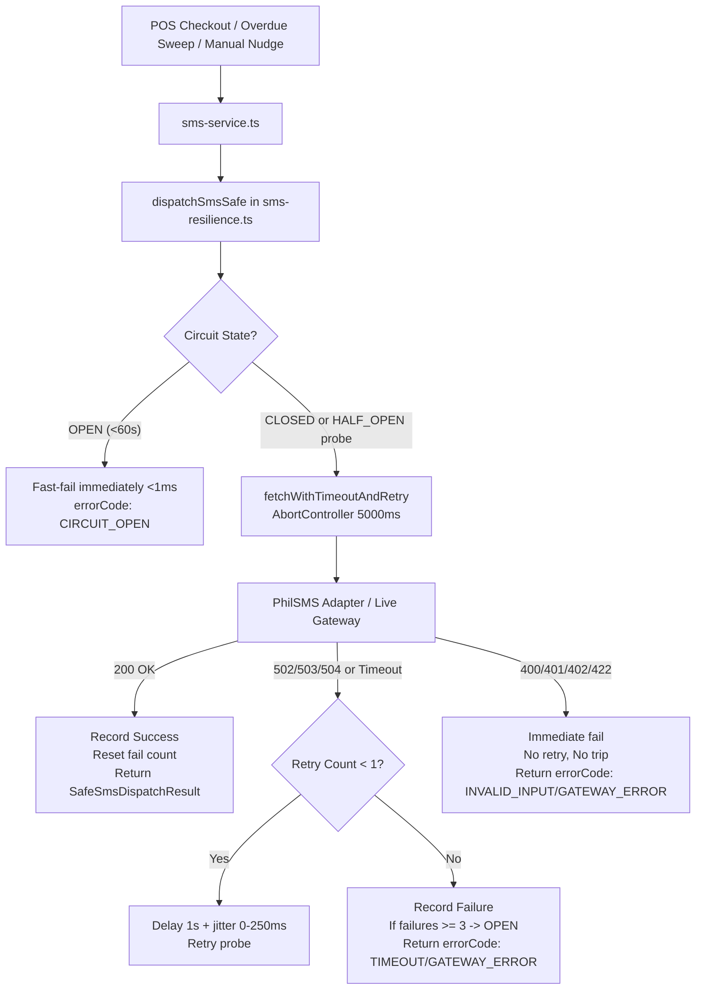

# Implementation Plan: SMS Gateway Resilience & Circuit Breaker (ARL-25)

## 1. Architectural Overview & Boundaries

## 2. File Modification & Creation Inventory

| File Path | Action | Description |
| :--- | :--- | :--- |
| `lib/services/sms-resilience.ts` | Create | Implements `CircuitBreaker` class, `fetchWithTimeoutAndRetry`, `dispatchSmsSafe`, and default singleton `smsCircuitBreaker`. |
| `lib/services/sms-service.ts` | Modify | Connects `dispatchSms` with `dispatchSmsSafe` to ensure zero-crash execution across all existing dispatch paths. |
| `tests/sms-resilience.test.ts` | Create | BDD unit test suite covering timeout aborts, 3-strike circuit tripping, 60s cooldown recovery, probe pass/fail, and non-blocking POS simulation. |
| `tests/unit/sms-resilience.test.ts` | Create | Re-exports or symlinks to `tests/sms-resilience.test.ts` for directory consistency with Jira DoD. |

## 3. Test Strategy

1. **Timeout Handling**:
   - Mock a fetch handler that delays 6,000ms.
   - Verify `AbortController` triggers at 5,000ms and returns `errorCode: 'TIMEOUT'` in ~5,000ms without throwing uncaught errors.
2. **Circuit Breaker State Machine**:
   - 3 consecutive gateway failures trip circuit to `OPEN`.
   - Verified that subsequent calls in `OPEN` return in < 2ms with `errorCode: 'CIRCUIT_OPEN'`.
   - Simulated 60s cooldown allows 1 probe in `HALF_OPEN`.
   - Successful probe restores `CLOSED`.
   - Failed probe returns to `OPEN` for another 60s.
3. **Transient Retry & Jitter**:
   - Initial HTTP 502 followed by HTTP 200 succeeds after 1 retry.
   - Non-retryable HTTP 401 / 402 fails on initial attempt without retry.
4. **POS Transaction Decoupling**:
   - Simulates POS checkout with database insert + SMS call.
   - Confirms sale transaction commits even when SMS fails or times out.
