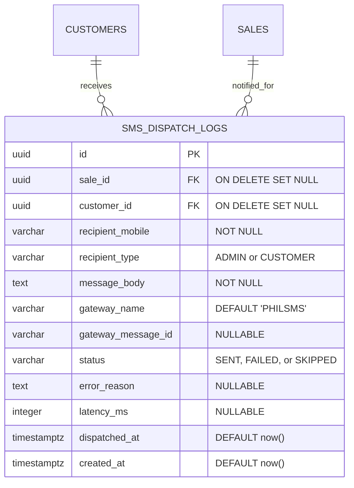

# Data Model: SMS Dispatch & Delivery Audit Ledger

**Feature Key**: `ARL-26`  
**Feature Slug**: `023-sms-dispatch-audit-ledger`  

---

## 1. Entity-Relationship Diagram



---

## 2. PostgreSQL DDL Schema

```sql
-- Migration: 20261118000000_sms_dispatch_logs_ledger.sql
CREATE TABLE IF NOT EXISTS public.sms_dispatch_logs (
    id UUID PRIMARY KEY DEFAULT gen_random_uuid(),
    sale_id UUID REFERENCES public.sales(id) ON DELETE SET NULL,
    customer_id UUID REFERENCES public.customers(id) ON DELETE SET NULL,
    recipient_mobile VARCHAR(20) NOT NULL,
    recipient_type VARCHAR(10) NOT NULL CHECK (recipient_type IN ('ADMIN', 'CUSTOMER')),
    message_body TEXT NOT NULL,
    gateway_name VARCHAR(20) NOT NULL DEFAULT 'PHILSMS',
    gateway_message_id VARCHAR(100) NULL,
    status VARCHAR(20) NOT NULL CHECK (status IN ('SENT', 'FAILED', 'SKIPPED')),
    error_reason TEXT NULL,
    latency_ms INTEGER NULL,
    dispatched_at TIMESTAMPTZ NOT NULL DEFAULT timezone('utc'::text, now()),
    created_at TIMESTAMPTZ NOT NULL DEFAULT timezone('utc'::text, now())
);

-- Performance Indexes
CREATE INDEX IF NOT EXISTS idx_sms_dispatch_logs_sale_id ON public.sms_dispatch_logs(sale_id);
CREATE INDEX IF NOT EXISTS idx_sms_dispatch_logs_customer_id ON public.sms_dispatch_logs(customer_id);
CREATE INDEX IF NOT EXISTS idx_sms_dispatch_logs_status_dispatched ON public.sms_dispatch_logs(status, dispatched_at DESC);
CREATE INDEX IF NOT EXISTS idx_sms_dispatch_logs_gateway_msg_id ON public.sms_dispatch_logs(gateway_message_id);

-- Row Level Security (RLS)
ALTER TABLE public.sms_dispatch_logs ENABLE ROW LEVEL SECURITY;

CREATE POLICY "Allow authenticated read sms_dispatch_logs"
    ON public.sms_dispatch_logs
    FOR SELECT
    TO authenticated
    USING (true);

CREATE POLICY "Allow authenticated insert sms_dispatch_logs"
    ON public.sms_dispatch_logs
    FOR INSERT
    TO authenticated
    WITH CHECK (true);

-- Immutability Protection Trigger
CREATE OR REPLACE FUNCTION public.prevent_sms_dispatch_logs_mutation()
RETURNS TRIGGER AS $$
BEGIN
    RAISE EXCEPTION 'sms_dispatch_logs is an immutable audit ledger. UPDATE and DELETE operations are strictly prohibited.';
END;
$$ LANGUAGE plpgsql;

DROP TRIGGER IF EXISTS trg_prevent_sms_dispatch_logs_mutation ON public.sms_dispatch_logs;
CREATE TRIGGER trg_prevent_sms_dispatch_logs_mutation
    BEFORE UPDATE OR DELETE ON public.sms_dispatch_logs
    FOR EACH ROW
    EXECUTE FUNCTION public.prevent_sms_dispatch_logs_mutation();
```

---

## 3. Data Transfer Objects (DTOs) & Zod Validation

```typescript
export type SmsRecipientType = 'ADMIN' | 'CUSTOMER';
export type SmsDispatchStatus = 'SENT' | 'FAILED' | 'SKIPPED';

export interface SmsDispatchLogDTO {
  id: string;
  sale_id: string | null;
  customer_id: string | null;
  recipient_mobile: string;
  recipient_type: SmsRecipientType;
  message_body: string;
  gateway_name: string;
  gateway_message_id: string | null;
  status: SmsDispatchStatus;
  error_reason: string | null;
  latency_ms: number | null;
  dispatched_at: string;
  created_at: string;
}

export interface CreateSmsDispatchLogInput {
  saleId?: string | null;
  customerId?: string | null;
  recipientMobile: string;
  recipientType: SmsRecipientType;
  messageBody: string;
  gatewayName?: string;
  gatewayMessageId?: string | null;
  status: SmsDispatchStatus;
  errorReason?: string | null;
  latencyMs?: number | null;
  dispatchedAt?: string;
}
```
