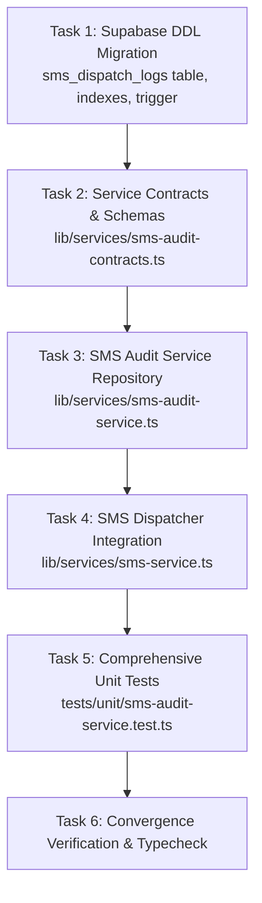

# Implementation Tasks: SMS Dispatch & Delivery Audit Ledger with Message ID Tracking

**Feature Key**: `ARL-26`  
**Feature Slug**: `023-sms-dispatch-audit-ledger`  

---

## Task Overview & Dependencies

---

## Phase 1: Database & Schemas (Unit 3)

- [ ] `TASK-1`: Create database migration script `supabase/migrations/20261118000000_sms_dispatch_logs_ledger.sql`
  - [ ] Define `public.sms_dispatch_logs` table with columns: `id`, `sale_id`, `customer_id`, `recipient_mobile`, `recipient_type`, `message_body`, `gateway_name`, `gateway_message_id`, `status`, `error_reason`, `latency_ms`, `dispatched_at`, `created_at`
  - [ ] Add check constraints: `recipient_type IN ('ADMIN', 'CUSTOMER')`, `status IN ('SENT', 'FAILED', 'SKIPPED')`
  - [ ] Add foreign keys `ON DELETE SET NULL` for `sale_id` and `customer_id`
  - [ ] Create indexes for `sale_id`, `customer_id`, `(status, dispatched_at DESC)`, and `gateway_message_id`
  - [ ] Configure RLS policies allowing authenticated users `SELECT` and `INSERT`
  - [ ] Create PostgreSQL trigger `trg_prevent_sms_dispatch_logs_mutation` preventing `UPDATE` and `DELETE`

## Phase 2: Domain Contracts & Services (Unit 4)

- [ ] `TASK-2`: Create `lib/services/sms-audit-contracts.ts`
  - [ ] Export `SmsRecipientType` ('ADMIN' | 'CUSTOMER') and `SmsDispatchStatus` ('SENT' | 'FAILED' | 'SKIPPED')
  - [ ] Export `SmsDispatchLogDTO` and `CreateSmsDispatchLogInput`
  - [ ] Define Zod schemas `createSmsDispatchLogSchema`, `smsRecipientTypeSchema`, `smsDispatchStatusSchema`
- [ ] `TASK-3`: Implement `lib/services/sms-audit-service.ts`
  - [ ] Implement `recordSmsDispatchLog(input, supabaseClient?)`
  - [ ] Implement `getSmsLogsBySaleId(saleId, supabaseClient?)`
  - [ ] Implement `getSmsLogsByCustomerId(customerId, supabaseClient?)`
  - [ ] Implement `getAllSmsLogs(options?, supabaseClient?)`
  - [ ] Provide in-memory storage fallback for local development and mock testing environments
  - [ ] Provide helper `_resetSmsAuditLogs()` for test harness isolation
- [ ] `TASK-4`: Integrate audit logging into `lib/services/sms-service.ts`
  - [ ] Update `dispatchSms` to record `SENT` or `FAILED` dispatches with `gateway_message_id`, `latency_ms`, `error_reason`
  - [ ] Record `SKIPPED` dispatches when phone number is missing, notification disabled, or 24h cooldown active
  - [ ] Ensure audit logging is non-blocking to prevent UI/POS stalls

## Phase 3: Automated Testing & Verification (Unit 4 & 6)

- [ ] `TASK-5`: Create unit test suite `tests/unit/sms-audit-service.test.ts`
  - [ ] Test recording successful PhilSMS dispatch (`SENT`, `gateway_message_id`, `latency_ms`)
  - [ ] Test recording gateway error or network failure (`FAILED`, `error_reason`, null `gateway_message_id`)
  - [ ] Test recording skipped dispatch (`SKIPPED`, `error_reason`)
  - [ ] Test querying audit records by `saleId` and verifying descending sort by `dispatched_at`
  - [ ] Test querying audit records by `customerId`
  - [ ] Test input schema validation rejecting invalid recipient types or statuses
  - [ ] Test integration with `dispatchSms` and `dispatchOverdueBalanceReminders`
- [ ] `TASK-6`: Convergence & Full Suite Validation
  - [ ] Run full test suite `npm test`
  - [ ] Run TypeScript typecheck `npm run typecheck`
  - [ ] Run linter `npm run lint`
  - [ ] Update documentation and task tracking checklists
