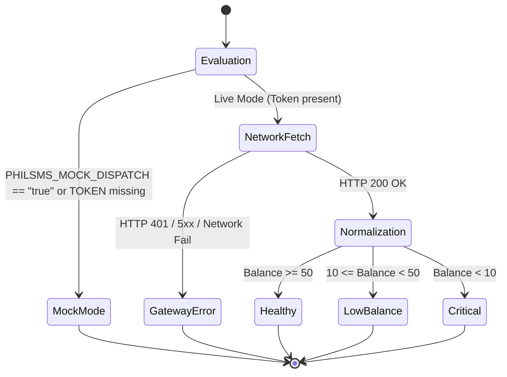

# Domain & Data Models: PhilSMS Credit Balance Monitor & Health Diagnostic

**Feature Key**: `ARL-27`  
**Feature Slug**: `024-philsms-credit-balance-monitor`  

---

## 1. Domain Entities & Value Objects

### 1.1 `PhilSmsAccountStatus` (Domain Model)

Represents the processed, normalized health and balance status of the PhilSMS gateway.

```typescript
export type PhilSmsHealthLevel = 'healthy' | 'warning' | 'critical' | 'mock' | 'error';

export interface PhilSmsAccountStatus {
  success: boolean;
  balance: number;
  currency: string;
  senderId: string;
  isMock: boolean;
  cached: boolean;
  cachedAt?: string;
  expiresAt?: string;
  warningLevel: PhilSmsHealthLevel;
  statusText: string;
  errorMessage?: string;
}
```

### 1.2 `PhilSmsBalanceRawResponse` (External Gateway DTO)

The JSON payload returned by PhilSMS v3 `GET https://app.philsms.com/api/v3/balance`.

```typescript
export interface PhilSmsBalanceRawResponse {
  status: 'success' | 'error';
  message?: string;
  data?: {
    balance: string | number;
    currency?: string;
    sender_id?: string;
  };
}
```

### 1.3 In-Memory Cache State Model

```typescript
export interface PhilSmsBalanceCacheEntry {
  status: PhilSmsAccountStatus;
  timestamp: number;
  ttlMs: number;
}
```

---

## 2. State Machine: Gateway Warning Levels



---

## 3. Threshold & Display Matrix

| State | Credit Range | UI Badge Semantic Class | Estimated PHP Value | Actionable Guidance |
| :--- | :--- | :--- | :--- | :--- |
| **Healthy** | $\ge 50$ credits | `bg-success-light text-success border-success-border` | `~PHP (credits * 0.50)` | Normal operation |
| **Warning** | $10 \le \text{credits} < 50$ | `bg-accent-light text-accent border-accent-border` | `~PHP (credits * 0.50)` | Top up soon via PhilSMS portal |
| **Critical** | $< 10$ credits | `bg-danger-light text-danger border-danger-border` | `~PHP (credits * 0.50)` | Urgent top-up required |
| **Mock** | N/A | `bg-bg-muted text-text-muted border-border-subtle` | Unlimited (Local Mock) | Offline mock mode active |
| **Error** | N/A | `bg-danger-light text-danger border-danger-border` | N/A | Check PHILSMS_API_TOKEN secret |
