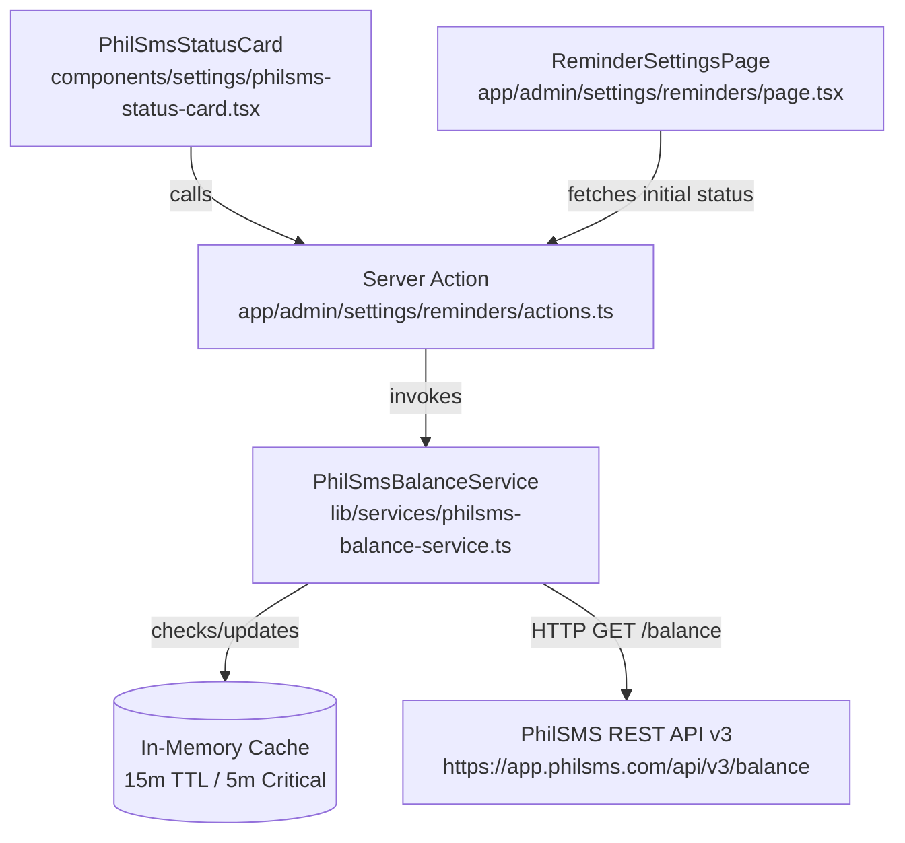

# Technical Implementation Plan: PhilSMS Credit Balance Monitor & Health Diagnostic

**Feature Key**: `ARL-27`  
**Feature Slug**: `024-philsms-credit-balance-monitor`  

---

## 1. Architectural Overview & Boundaries

---

## 2. Component Hierarchy & Deliverables

1. **Service Layer**: `lib/services/philsms-balance-service.ts`
   - External API caller for `/api/v3/balance`
   - Cache store with TTL (15 min standard / 5 min critical)
   - Low-balance (<50) and critical (<10) evaluator
   - Peso currency converter (`credits * 0.50`)
   - Mock mode resolver

2. **Server Actions**: `app/(admin)/settings/reminders/actions.ts`
   - `getPhilSmsAccountStatusAction()`
   - `refreshPhilSmsBalanceAction()`

3. **UI Component**: `components/settings/philsms-status-card.tsx`
   - Status badge (Connected / Mock / Low Balance / Critical / Error)
   - Credits count & estimated PHP value
   - Sender ID pill
   - Warning alert banner (low balance: accent, critical: danger)
   - On-demand "Refresh Balance" button with loading state

4. **Integration**: `app/(admin)/settings/reminders/page.tsx` & `components/settings/reminder-settings-form.tsx`
   - Render `<PhilSmsStatusCard initialStatus={initialPhilSmsStatus} />` above or within the reminder settings view.

5. **Unit Tests**: `tests/unit/philsms-balance.test.ts`
   - Threshold tests (>=50 healthy, 10-49 warning, <10 critical)
   - Caching duration and bypass with `forceRefresh: true`
   - Error handling & mock mode
