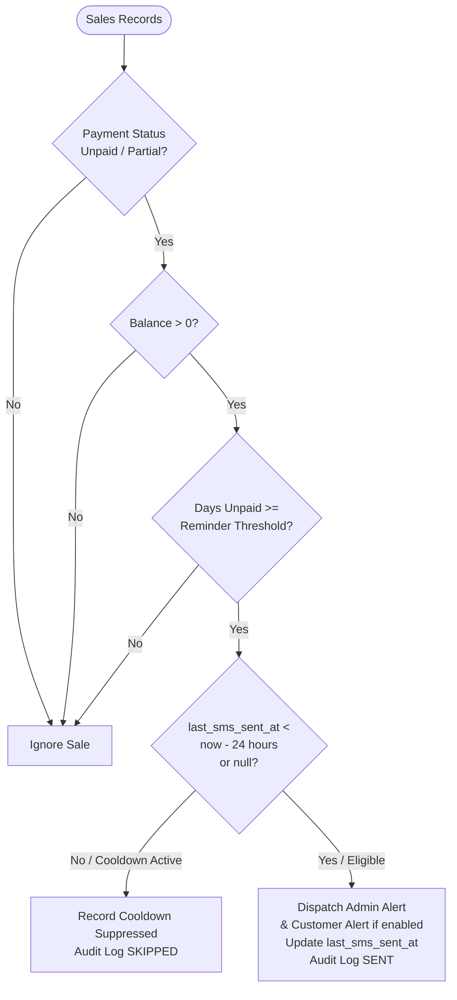

# Domain & Data Models: Automated Scheduled Overdue Sweep Orchestrator

**Feature Key**: `ARL-28`  
**Feature Slug**: `025-scheduled-overdue-sms-sweep`  
**Epic**: EPIC-5: Production SMS Gateway Infrastructure & Telecom Delivery (PhilSMS) (`ARL-23`)  

---

## 1. Domain Entities & Value Objects

### 1.1 `CronSweepSummary` (Execution Metrics Model)

Represents the aggregated metrics produced by an overdue sweep execution.

```typescript
export interface CronSweepSummary {
  salesEvaluated: number;
  eligibleOverdue: number;
  cooldownSuppressed: number;
  adminSmsDispatched: number;
  customerSmsDispatched: number;
  customerSmsSkipped: number;
  errors: number;
  durationMs: number;
}
```

### 1.2 `CronRouteResponse` (API Response DTO)

Standardized JSON envelope returned by `GET` and `POST` on `/api/cron/overdue-sms-sweep`.

```typescript
export interface CronRouteResponse {
  success: boolean;
  timestamp: string;
  summary?: CronSweepSummary;
  error?: string;
}
```

### 1.3 `OverdueSweepOptions` (Service Options DTO)

Configuration parameters accepted by the sweep orchestrator.

```typescript
import type { SupabaseClient } from '@supabase/supabase-js';

export interface OverdueSweepOptions {
  asOfDate?: Date;
  throttleMs?: number; // Delay between dispatches (default: 150ms)
  supabaseClient?: SupabaseClient | null;
}
```

---

## 2. State & Filtering Pipeline



---

## 3. Cooldown & Threshold Rules Matrix

| Criteria | Invariant Rule | Action Taken | Metric Impact |
| :--- | :--- | :--- | :--- |
| **Fully Paid / Zero Balance** | `balance <= 0` or status `PAID` | Excluded from evaluation | Non-eligible |
| **Not Yet Overdue** | `days_unpaid < settings.reminder_days` | Excluded from dispatch | Non-eligible |
| **Within 24h Cooldown** | `now - last_sms_sent_at < 24h` | Suppressed; audit log marked `SKIPPED` | `cooldownSuppressed += 1` |
| **Eligible Overdue** | `balance > 0`, `days >= threshold`, cooldown clear | Dispatched via `dispatchSmsSafe`; timestamp updated | `adminSmsDispatched += 1` |
| **Customer SMS Disabled** | `settings.notify_customer_sms === false` | Customer alert omitted; logged to audit | `customerSmsSkipped += 1` |
| **Invalid Customer Phone** | Phone not valid Philippine mobile format | Customer alert omitted; logged to audit | `customerSmsSkipped += 1` |
| **Gateway Failure** | PhilSMS timeout / carrier reject | Error caught, logged to audit; batch continues | `errors += 1` |
