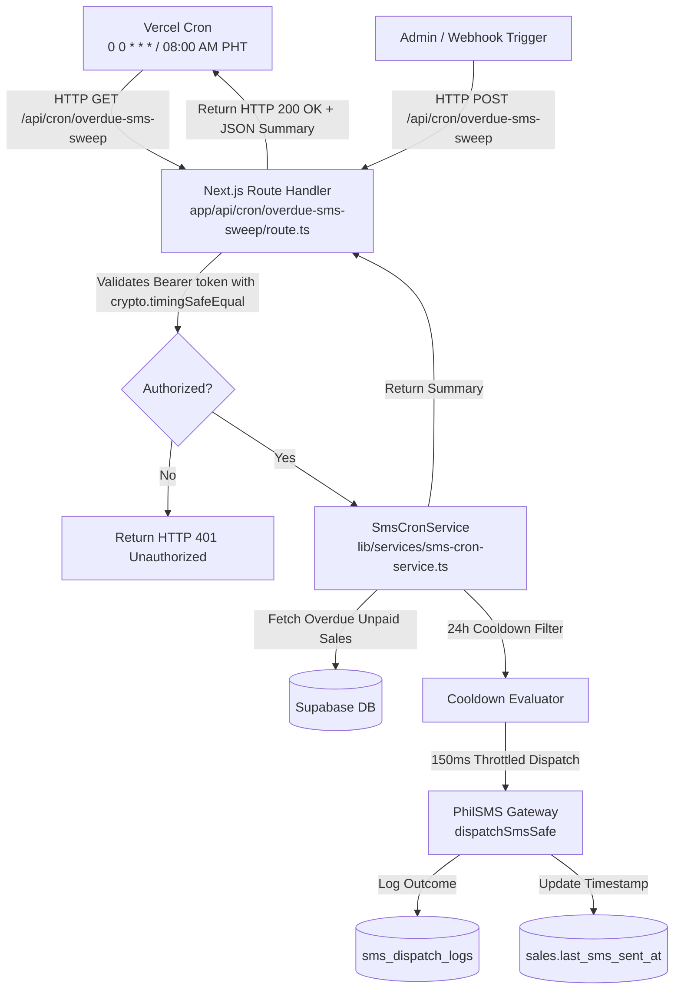

# Technical Implementation Plan: Automated Scheduled Overdue Sweep Orchestrator

**Feature Key**: `ARL-28`  
**Feature Slug**: `025-scheduled-overdue-sms-sweep`  
**Epic**: EPIC-5: Production SMS Gateway Infrastructure & Telecom Delivery (PhilSMS) (`ARL-23`)  

---

## 1. Architectural Overview & Boundaries

---

## 2. Component Hierarchy & Deliverables

1. **Vercel Cron Configuration (`vercel.json`)**:
   - Define crons entry: `{"path": "/api/cron/overdue-sms-sweep", "schedule": "0 0 * * *"}`.
   - Update `.env.example` with `CRON_SECRET=`.

2. **Cron Service Orchestrator (`lib/services/sms-cron-service.ts`)**:
   - `isAuthorizedCronRequest(authHeader, cronSecret)`
   - `executeOverdueSmsSweep(options?: OverdueSweepOptions): Promise<CronSweepSummary>`
   - Throttled pacing with `throttleMs` delay (default: 150ms)
   - Concurrency control & partial failure error isolation
   - Updating `last_sms_sent_at` on successful dispatch

3. **Next.js Route Handler (`app/api/cron/overdue-sms-sweep/route.ts`)**:
   - Accepts both `GET` and `POST` methods
   - Calls `isAuthorizedCronRequest(request.headers.get('authorization'))`
   - Returns HTTP 401 Unauthorized if check fails
   - Returns HTTP 200 OK with `CronRouteResponse` upon completion
   - Catches uncaught server errors and returns HTTP 500

4. **Integration Test Suite (`tests/integration/cron-overdue-sweep.test.ts`)**:
   - Verifies HTTP 401 on missing or mismatched bearer tokens
   - Verifies constant-time comparison helper behavior
   - Verifies 24-hour cooldown suppression
   - Verifies customer SMS skipping when `notify_customer_sms === false`
   - Verifies batch resilience when a gateway error occurs
   - Verifies response summary metrics and duration calculations
