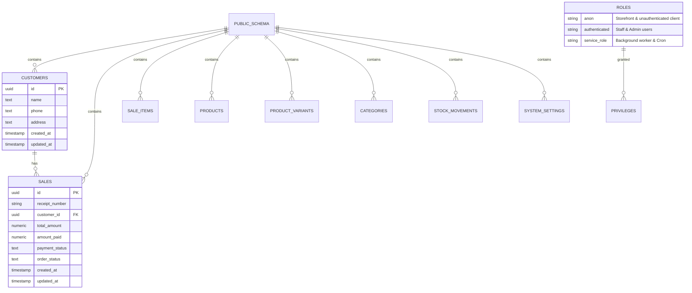
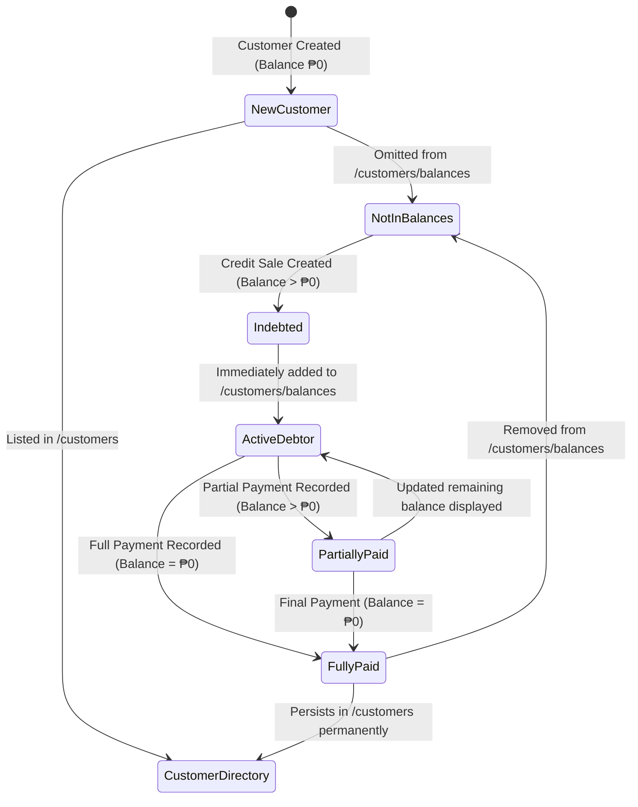

# Domain & Data Models: Customer Profile Persistence & Real-Time Balances Cache Invalidation

**Feature Key**: `ARL-37`  
**Feature Slug**: `026-customer-profile-persistence-balances-sync`  
**Jira Story**: STORY-4.4: Customer Profile Persistence & Real-Time Balances Cache Invalidation  
**Epic**: `EPIC-4: Analytics, Dashboard & Reporting` (`ARL-17`)  

---

## 1. PostgreSQL Schema & Privilege Model

---

## 2. Invalidation Event & Route Invalidation Mapping

| Event / Mutation | Originating Server Action | Target Routes Invalidated | Justification |
| :--- | :--- | :--- | :--- |
| **Customer Created** | `createCustomerAction(input)` | `/customers` `/customers/${id}` `/customers/balances` `/reports/balances` `/dashboard` | Adds customer to directory; refreshes stats and balances cache |
| **Customer Updated** | `updateCustomerAction(id, input)` | `/customers` `/customers/${id}` `/customers/balances` `/reports/balances` `/dashboard` | Updates phone/name across directory, utang tracker, and reports |
| **New Sale Registered** | `submitNewSale(input)` | `/sales` `/sales/new` `/inventory` `/customers` `/customers/balances` `/reports/balances` `/dashboard` | Creates debt balance if unpaid/partial; updates debtor list on Utang Tracker |
| **Sale Payment Updated** | `updateSalePaymentAction(input)` | `/sales` `/sales/${saleId}` `/customers` `/customers/balances` `/reports/balances` `/dashboard` | Decreases debt balance; removes debtor from Utang Tracker if fully settled |
| **SMS Reminder Sent** | `sendCustomerSmsReminderAction(input)` | `/sales/${saleId}` `/customers/balances` `/dashboard` | Updates last contact / cooldown state on debtor row |

---

## 3. Utang Filter State Transitions

