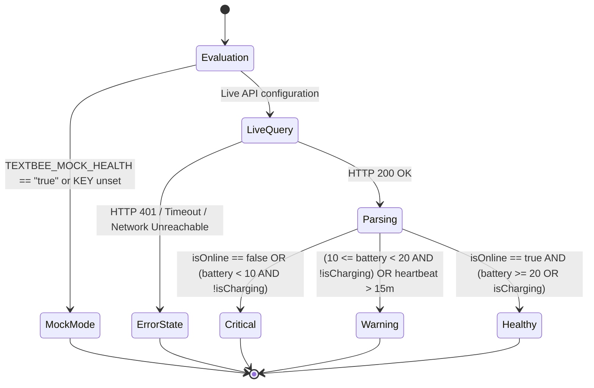

# Domain & Data Models: TextBee Device Connection Health Diagnostic

**Feature Key**: `ARL-43`  
**Feature Slug**: `028-textbee-device-health-diagnostic`  

---

## 1. Domain Entities & Value Objects

### 1.1 `TextBeeDeviceHealth` (Domain Model)

Represents normalized Android smartphone gateway connection state, battery level, charging status, and network connectivity.

```typescript
export type TextBeeHealthLevel = 'healthy' | 'warning' | 'critical' | 'mock' | 'error';
export type TextBeeNetworkType = 'WIFI' | 'CELLULAR' | 'ETHERNET' | 'NONE' | 'UNKNOWN';

export interface TextBeeDeviceHealth {
  success: boolean;
  deviceId: string;
  deviceName: string;
  deviceModel?: string;
  isOnline: boolean;
  batteryPercentage: number;
  isCharging: boolean;
  networkType: TextBeeNetworkType;
  signalStrength?: number; // 0-4 or percentage
  lastSeenAt: string; // ISO 8601
  warningLevel: TextBeeHealthLevel;
  statusText: string;
  isMock: boolean;
  cached: boolean;
  cachedAt?: string;
  expiresAt?: string;
  errorMessage?: string;
}
```

### 1.2 `TextBeeRawDeviceResponse` (External API DTO)

```typescript
export interface TextBeeRawDeviceResponse {
  id: string;
  name?: string;
  model?: string;
  status?: string; // 'ONLINE' | 'OFFLINE'
  battery?: {
    percentage: number;
    isCharging: boolean;
  } | number;
  network?: {
    type?: string;
    signal?: number;
  } | string;
  updatedAt?: string;
  lastSeen?: string;
}
```

### 1.3 `SmsGatewayDiagnostic` (Polymorphic Model)

Combines multiple gateway options for polymorphic UI presentation.

```typescript
export interface UnifiedSmsGatewayStatus {
  activeGateway: 'PHILSMS' | 'TEXTBEE' | 'DUAL';
  philsms?: PhilSmsAccountStatus;
  textbee?: TextBeeDeviceHealth;
}
```

---

## 2. Threshold & Warning State Machine



---

## 3. Threshold & Display Matrix

| State | Battery & Connectivity Conditions | Semantic Badge Class | Guidance / Action |
| :--- | :--- | :--- | :--- |
| **Healthy** | Online, Battery $\ge 20\%$ or Charging | `bg-success-light text-success border-success-border` | Gateway operational and ready for SMS dispatch |
| **Warning** | Online, $10\% \le \text{Battery} < 20\%$ discharging | `bg-accent-light text-accent border-accent-border` | Connect charger to prevent phone shutdown |
| **Critical** | Offline or Battery $< 10\%$ discharging | `bg-danger-light text-danger border-danger-border` | Phone offline or dead. Urgent staff action required |
| **Mock** | Offline / Local mock mode | `bg-bg-muted text-text-muted border-border-subtle` | Local offline development simulation |
| **Error** | API 401, Invalid Key, Unreachable | `bg-danger-light text-danger border-danger-border` | Check TEXTBEE_API_KEY and device ID |
