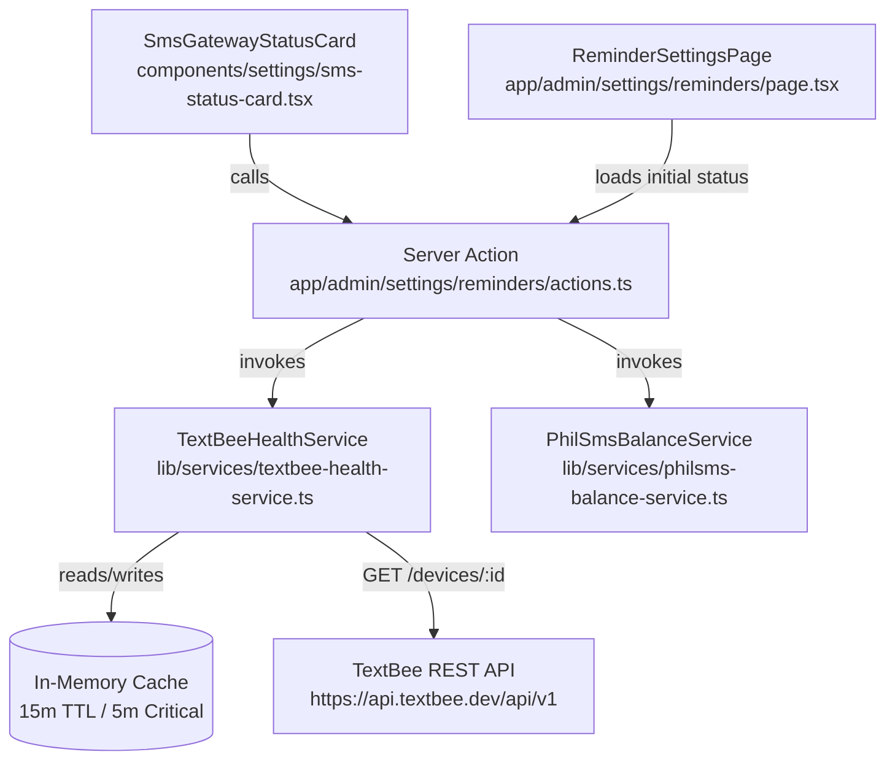

# Technical Implementation Plan: TextBee Device Connection Health Diagnostic

**Feature Key**: `ARL-43`  
**Feature Slug**: `028-textbee-device-health-diagnostic`  

---

## 1. Architectural Overview & Boundaries

---

## 2. Component Deliverables & Layers

### Layer 1: Contracts & Domain Types
- `lib/services/textbee-contracts.ts`:
  - `TextBeeDeviceHealth`, `TextBeeHealthLevel`, `TextBeeNetworkType`
  - Zod schemas for device parsing and validation
  - Default URLs and constant configurations

### Layer 2: Service Layer & Caching
- `lib/services/textbee-health-service.ts`:
  - `getTextBeeDeviceHealth({ forceRefresh?: boolean })`
  - `evaluateDeviceHealthLevel(params)`
  - Resilient mock mode fallback
  - TTL-based in-memory caching (15m standard, 5m critical/offline)
  - Unit test harnesses (`_resetTextBeeHealthCache`, `_setTestTextBeeHealthOverride`)

### Layer 3: Server Actions
- `app/(admin)/settings/reminders/actions.ts`:
  - `getTextBeeDeviceHealthAction()`
  - `refreshTextBeeDeviceHealthAction()`
  - `getSmsGatewayStatusAction()`

### Layer 4: Polymorphic UI Component
- `components/settings/sms-status-card.tsx` (and keeping `philsms-status-card.tsx` compatible):
  - Polymorphic or multi-gateway tab/switcher card
  - Displays device status, battery level with visual charge badge, network status, last heartbeat
  - Warning banners for low battery (<20%) or critical offline state
  - Interactive "Refresh Connection" button with animated spin and toast feedback
  - Zero hardcoded colors; strict semantic token usage

### Layer 5: Page Integration & Verification
- `app/(admin)/settings/reminders/page.tsx`:
  - Fetch both gateway states concurrently via `Promise.all`
  - Render the updated status card
- Unit and integration tests in `tests/textbee-health.test.ts` and `tests/unit/sms-status-card.test.tsx`
