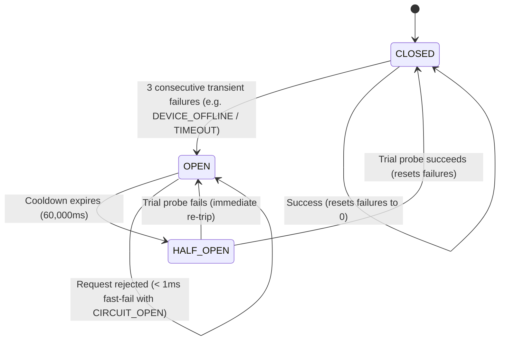

# Domain & Data Models: TextBee Resilience Circuit Breaker & Audit Ledger

**Feature Key**: `ARL-42`  
**Feature Slug**: `029-textbee-resilience-circuit-breaker-audit`  

---

## 1. Circuit Breaker State Machine



### State Definitions

| State | Allowed Traffic | Behavior on Failure | Transition Trigger |
| :--- | :--- | :--- | :--- |
| `CLOSED` | $100\%$ of traffic allowed | Consecutive failures incremented | Trips to `OPEN` when failure count reaches threshold (3) |
| `OPEN` | $0\%$ traffic allowed (fast-fail) | N/A (calls blocked immediately in $< 1\text{ms}$) | Shifts to `HALF_OPEN` after 60s cooldown |
| `HALF_OPEN` | Exactly 1 probe request | Immediate trip back to `OPEN` | Returns to `CLOSED` on success; trips to `OPEN` on failure |

---

## 2. TextBee Send & Error Contracts

### 2.1 TextBee Error Code Taxonomy

```typescript
export type TextBeeErrorCode =
  | 'DEVICE_OFFLINE'        // Paired phone disconnected, offline, or battery dead
  | 'DEVICE_NOT_FOUND'      // 404: Device ID invalid or deleted
  | 'GATEWAY_AUTH_ERROR'   // 401: API Key invalid
  | 'GATEWAY_BAD_REQUEST'   // 400: Malformed body or parameters
  | 'GATEWAY_RATE_LIMITED'  // 429: Cloud or device rate limit reached
  | 'GATEWAY_SERVER_ERROR'  // 500/502/503/504: Internal server error
  | 'NETWORK_UNREACHABLE'   // Socket connection or fetch failure
  | 'TIMEOUT'               // AbortController 5,000ms deadline exceeded
  | 'INVALID_RECIPIENT_MOBILE'; // Invalid phone format
```

### 2.2 TextBee Send Result DTO

```typescript
export interface TextBeeSendResult {
  success: boolean;
  messageId?: string;
  errorMessage?: string;
  errorCode?: TextBeeErrorCode;
  rawResponse?: unknown;
}
```

---

## 3. Database Audit Ledger Schema (`public.sms_dispatch_logs`)

| Column Name | PostgreSQL Type | Nullable | Default | Description |
| :--- | :--- | :--- | :--- | :--- |
| `id` | `UUID` | No | `gen_random_uuid()` | Unique primary key |
| `sale_id` | `UUID` | Yes | `NULL` | Foreign key to `sales.id` (if triggered from receipt) |
| `customer_id` | `UUID` | Yes | `NULL` | Foreign key to `customers.id` (if customer reminder) |
| `recipient_mobile` | `VARCHAR(20)` | No | N/A | Normalized mobile number (`09XXXXXXXXX` / `+639...`) |
| `recipient_type` | `VARCHAR(10)` | No | N/A | Check constraint: `'ADMIN'` or `'CUSTOMER'` |
| `message_body` | `TEXT` | No | N/A | Exact dispatched SMS content |
| `gateway_name` | `VARCHAR(20)` | No | `'PHILSMS'` | Set to `'TEXTBEE'` for TextBee dispatches |
| `gateway_message_id` | `VARCHAR(100)` | Yes | `NULL` | TextBee message UUID / ID |
| `status` | `VARCHAR(20)` | No | N/A | Check constraint: `'SENT'`, `'FAILED'`, `'SKIPPED'` |
| `error_reason` | `TEXT` | Yes | `NULL` | Error details if failed or skipped |
| `latency_ms` | `INTEGER` | Yes | `NULL` | Round-trip duration in milliseconds (`execution_latency_ms`) |
| `dispatched_at` | `TIMESTAMPTZ` | No | `now()` | Dispatch timestamp |
| `created_at` | `TIMESTAMPTZ` | No | `now()` | Record creation timestamp |

---

## 4. Resilience Error Code Mapping

| Gateway Event / Error | Retryable? | Trips Breaker? | ResilienceErrorCode |
| :--- | :--- | :--- | :--- |
| TextBee Device Offline / Disconnected | Yes (transient) | Yes (on threshold) | `GATEWAY_ERROR` |
| TextBee 5,000ms Timeout | Yes (transient) | Yes (on threshold) | `TIMEOUT` |
| TextBee HTTP 500 / 502 / 503 / 504 | Yes (transient) | Yes (on threshold) | `GATEWAY_ERROR` |
| TextBee HTTP 429 Rate Limit | Yes (transient) | Yes (on threshold) | `GATEWAY_ERROR` |
| Network Socket / Fetch Error | Yes (transient) | Yes (on threshold) | `GATEWAY_ERROR` |
| TextBee HTTP 401 Auth Error | No (permanent) | No | `GATEWAY_ERROR` |
| TextBee HTTP 400 Bad Request | No (permanent) | No | `GATEWAY_ERROR` |
| Invalid Phone Number Format | No (permanent) | No | `INVALID_INPUT` |
| Circuit Breaker is `OPEN` | No (fast-fail) | N/A | `CIRCUIT_OPEN` |
