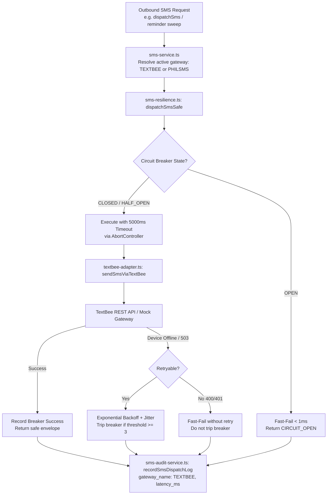

# Technical Implementation Plan: TextBee Resilience Circuit Breaker & Audit Ledger

**Feature Key**: `ARL-42`  
**Feature Slug**: `029-textbee-resilience-circuit-breaker-audit`  

---

## 1. Architecture & Boundary Mapping

---

## 2. File Modification & Creation Matrix

| File Path | Operation | Description |
| :--- | :--- | :--- |
| `lib/services/textbee-contracts.ts` | Edit | Add TextBee send contracts, error codes, and result schemas. |
| `lib/services/textbee-adapter.ts` | Create | Implement `sendSmsViaTextBee`, mock generator, error normalization, and test override hooks. |
| `lib/services/sms-resilience.ts` | Edit | Extend `isRetryableError` for TextBee codes, integrate gateway selector into `dispatchSmsSafe`, map TextBee errors. |
| `lib/services/sms-audit-contracts.ts` | Edit | Ensure `gatewayName` and `executionLatencyMs` / `latencyMs` mapping is fully bidirectional. |
| `lib/services/sms-service.ts` | Edit | Pass active gateway (`TEXTBEE` vs `PHILSMS`) through to `dispatchSmsSafe` and `recordSmsDispatchLog`. |
| `tests/unit/textbee-resilience.test.ts` | Create | Comprehensive unit test suite covering circuit breaker tripping, recovery, timeout protection, and audit logging. |

---

## 3. Implementation Phases

- **Phase 1: Domain Contracts & Adapter**
  - Define `TextBeeErrorCode`, `TextBeeSendOptions`, `TextBeeSendResult` in `lib/services/textbee-contracts.ts`.
  - Author `sendSmsViaTextBee` in `lib/services/textbee-adapter.ts` with offline mock fallback, error mapping, and timeout propagation.

- **Phase 2: Circuit Breaker & Resilience Engine Updates**
  - Update `isRetryableError()` in `lib/services/sms-resilience.ts` to recognize `DEVICE_OFFLINE` as a transient, retryable error that increments failure count and trips the breaker.
  - Update `dispatchSmsSafe()` to support TextBee gateway dispatching alongside PhilSMS.
  - Map TextBee offline, 400, 401, 500 responses to `ResilienceErrorCode`.

- **Phase 3: Audit Ledger Verification & Integration**
  - Verify `sms-dispatch-audit-service.ts` persists `gateway_name = "TEXTBEE"`.
  - Ensure `sms-service.ts` respects gateway selection and records accurate execution latency.

- **Phase 4: Unit Test Suite & Verification**
  - Author `tests/unit/textbee-resilience.test.ts` validating all scenarios.
  - Run full test regression suite (`npm test`) and typecheck (`npm run typecheck`).
