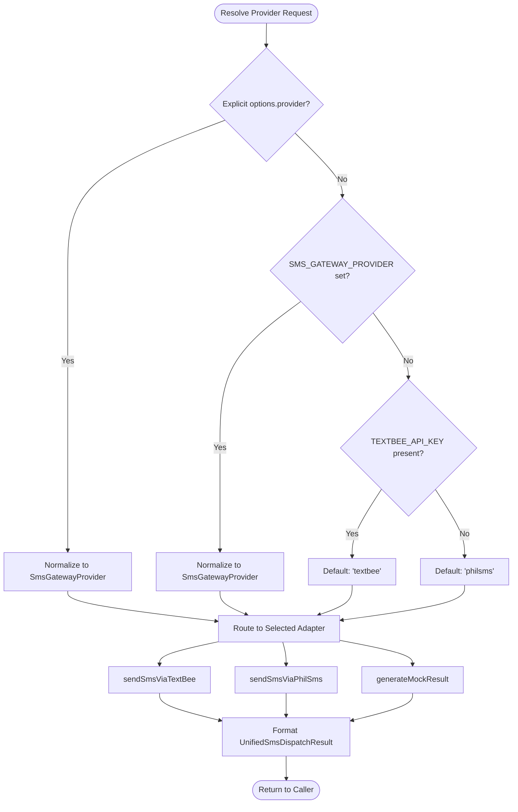

# Data Model & Domain Contracts: Pluggable Multi-Gateway Router (ARL-41)

## 1. Core Types & Enums

### 1.1 `SmsGatewayProvider`
Union of supported provider keys:
```typescript
export type SmsGatewayProvider = 'textbee' | 'philsms' | 'mock';
```

### 1.2 `UnifiedSmsDispatchOptions`
Options passed to the router:
```typescript
export interface UnifiedSmsDispatchOptions {
  /** Target Philippine mobile number in clean or E.164 format */
  recipient: string;
  /** SMS message content */
  message: string;
  /** Optional custom sender ID (e.g. "PhilSMS" or store brand) */
  senderId?: string;
  /** AbortSignal for enforcing timeouts from resilience layer */
  signal?: AbortSignal;
  /** Optional runtime provider override */
  provider?: SmsGatewayProvider | string;
}
```

### 1.3 `UnifiedSmsDispatchResult`
Normalized outcome returned by `dispatchGatewaySms`:
```typescript
export interface UnifiedSmsDispatchResult {
  /** Indicates whether the SMS was accepted/sent by the provider */
  success: boolean;
  /** Provider-assigned or synthetic message identifier */
  messageId?: string;
  /** The actual provider that executed the dispatch */
  provider: SmsGatewayProvider;
  /** Normalized or provider-specific error message if failed */
  errorMessage?: string;
  /** Standardized error code for resilience retry categorization */
  errorCode?: string;
  /** Untransformed provider response payload for debugging and audit logs */
  rawResponse?: unknown;
}
```

---

## 2. State Machine & Resolution Flow


