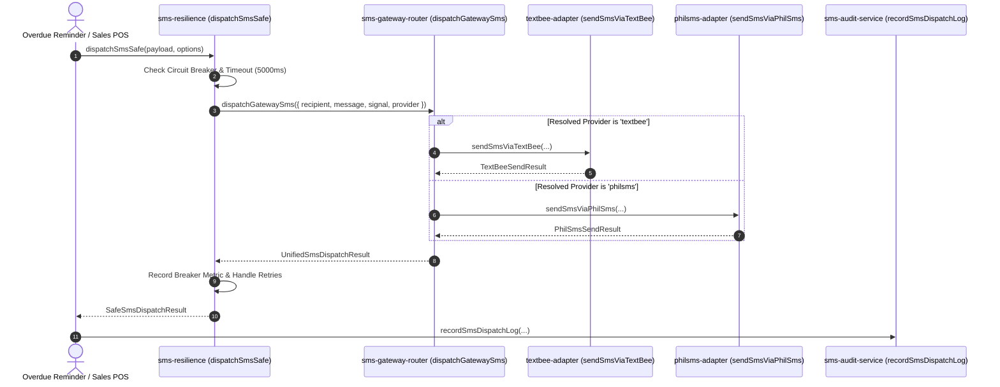

# Architecture & Technical Research: Pluggable Multi-Gateway Router (ARL-41)

## 1. Problem Statement & Background

The ARLQ system originally delivered overdue reminder SMS exclusively via the PhilSMS cloud gateway (`lib/services/philsms-adapter.ts`). With the addition of TextBee mobile SIM gateway (`lib/services/textbee-adapter.ts`), the system gained physical Android SIM carrier capabilities.

Currently, provider selection logic is hardcoded inside `sms-resilience.ts` and `sms-service.ts` with direct `targetGateway === 'TEXTBEE'` branch checks. This tight coupling violates the Open/Closed Principle and complicates switching or failover strategies.

ARL-41 introduces a dedicated `sms-gateway-router.ts` service that abstracts provider selection behind a unified dispatch interface and standard result format.

---

## 2. Technical Stack & Architectural Patterns

- **Language / Runtime**: TypeScript 5, Node.js 20+ / Next.js Server Environment.
- **Patterns**:
  - **Strategy Pattern**: `SmsGatewayProvider` selects between `textbee`, `philsms`, and `mock` strategies.
  - **Facade / Adapter Pattern**: Normalizes `PhilSmsSendResult` and `TextBeeSendResult` into `UnifiedSmsDispatchResult`.
  - **Precedence Hierarchy**:
    1. Explicit function argument (`options.provider`)
    2. Environment flag (`SMS_GATEWAY_PROVIDER` or legacy `ACTIVE_SMS_GATEWAY`)
    3. Auto-detection (`TEXTBEE_API_KEY` $\to$ `'textbee'`, else `'philsms'`)
    4. Safe mock fallback for CI / testing environments.

---

## 3. Component Interaction Diagram

---

## 4. Key Decisions & Rationale

1. **Clean Separation of Concerns**:
   - `sms-gateway-router.ts` does **not** manage circuit breaking or timeouts; those remain the responsibility of `sms-resilience.ts`.
   - `sms-gateway-router.ts` only resolves the active provider, constructs provider-specific payloads, invokes the adapter, and returns a normalized response.

2. **Case-Insensitive Resolution**:
   - Environment variables like `SMS_GATEWAY_PROVIDER="TEXTBEE"`, `"textbee"`, `"TextBee"` or `"philsms"` must parse reliably without developer friction.

3. **Non-Breaking Type Aliases**:
   - Existing code referencing `SmsGateway` (`'PHILSMS' | 'TEXTBEE'`) continues to compile cleanly.
   - `SmsGatewayProvider` is typed as `'textbee' | 'philsms' | 'mock'`.
