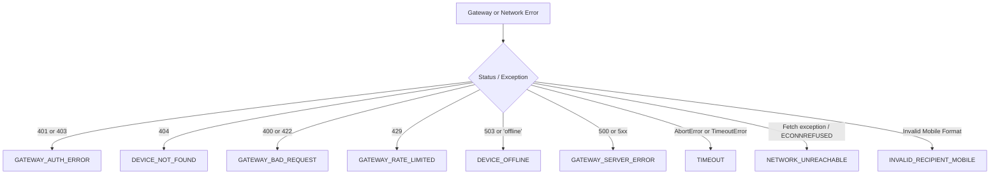

# Data Model & State Specifications: TextBee REST Gateway Client Adapter

**Feature Key**: `ARL-40`  
**Feature Slug**: `031-textbee-gateway-adapter`  

---

## 1. Entity Models & DTOs

### 1.1 TextBeeSendOptions
Represents the request options submitted to `sendSmsViaTextBee`:

| Field | Type | Required | Description |
|---|---|---|---|
| `recipient` | `string` | Yes | Target phone number (09..., +639..., 639...) |
| `message` | `string` | Yes | Outbound SMS message body |
| `signal` | `AbortSignal` | No | Optional timeout/cancellation signal |
| `apiKey` | `string` | No | Override for `TEXTBEE_API_KEY` |
| `deviceId` | `string` | No | Override for `TEXTBEE_DEVICE_ID` |
| `baseUrl` | `string` | No | Override for `TEXTBEE_BASE_URL` |

### 1.2 TextBeeSendResult
Standardized result returned after dispatch attempt:

| Field | Type | Required | Description |
|---|---|---|---|
| `success` | `boolean` | Yes | Whether the dispatch succeeded or failed |
| `messageId` | `string` | No | Unique gateway or synthetic mock message ID |
| `recipient` | `string` | Yes | Canonical E.164 recipient phone (`+639XXXXXXXXX`) |
| `gateway` | `'TEXTBEE'` | Yes | Literal gateway identifier |
| `errorCode` | `TextBeeErrorCode` | No | Standardized error code if failed |
| `errorMessage` | `string` | No | Diagnostic error message |
| `rawResponse` | `unknown` | No | Upstream API response payload or mock metadata |

### 1.3 TextBeeMockMessage
In-memory mock log entry stored in the testing registry:

| Field | Type | Description |
|---|---|---|
| `recipient` | `string` | Normalized E.164 recipient number |
| `message` | `string` | Dispatched message content |
| `timestamp` | `string` | ISO 8601 timestamp of mock dispatch |
| `messageId` | `string` | Generated synthetic message ID |
| `deviceId` | `string` | Target device ID |

---

## 2. Error Classification Mapping

