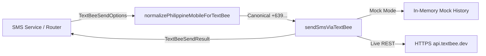

# Implementation Plan: TextBee REST Gateway Client Adapter, Phone Normalizer & Mock Engine

**Feature Key**: `ARL-40`  
**Feature Slug**: `031-textbee-gateway-adapter`  

---

## 1. Architecture & Component Boundary

## 2. File Change Plan

| File | Action | Description |
|---|---|---|
| `lib/services/textbee-contracts.ts` | Update | Add `gateway: 'TEXTBEE'`, `recipient: string` to `textBeeSendResultSchema`, export `TextBeeMockRecord`. |
| `lib/services/textbee-adapter.ts` | Update | Implement `normalizePhilippineMobileForTextBee`, integrate in-memory mock history (`_getTextBeeMockHistory`, `_resetTextBeeMockHistory`), attach `gateway: 'TEXTBEE'` and canonical `recipient` to all return paths, handle timeout and error mapping. |
| `.env.example` | Update | Document `TEXTBEE_API_KEY`, `TEXTBEE_DEVICE_ID`, `TEXTBEE_BASE_URL`, `TEXTBEE_MOCK_DISPATCH`. |
| `tests/unit/textbee-adapter.test.ts` | Create | Comprehensive unit tests for normalization, live dispatch with fetch mock, offline mock mode, error mapping, and security isolation. |

## 3. Verification Strategy

1. Run unit test suite: `npx vitest run tests/unit/textbee-adapter.test.ts`
2. Run existing textbee tests to ensure no regression: `npx vitest run tests/unit/textbee-health.test.ts tests/textbee-resilience.test.ts`
3. Run project typecheck: `npm run typecheck`
